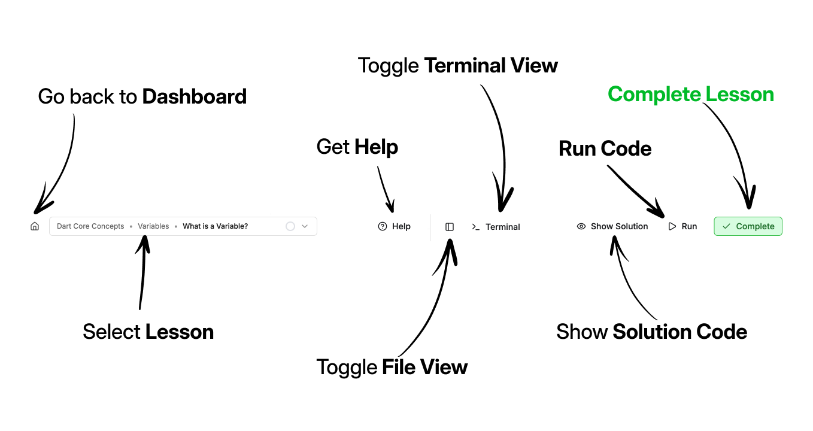

# Welcome to the Dart Course

Welcome to the Dart course! We're delighted to have you here and look forward to helping you on your journey to becoming a developer.

In this course, you will learn everything you need to know to start building with Dart.

## Interactive Course

This course is interactive. We believe the only way real learning happens is by doing. 

On the left side (top on mobile), you will see the learning material you need to pass this lesson. 

On the right side (bottom on mobile), you will see an interactive challenge. It will be either a quiz for a lesson covering theoretical concepts or, since this is a programming course, a coding challenge that you will execute directly in the browser. 

## Coding Walk-Through

At the bottom of each lesson, you will see a `Challenge`. This is what you must try to accomplish on the right side. 

> You can find the challenge for this lesson at the bottom, but don't scroll down and do it yet. Go through the next steps :)

1. Click the `Run` button to run the program. You will see a prompt asking you for your name in the `Interactive Terminal` below. 

2. Type your name and press enter. You should now see `Hlelo,` followed by your name. 

3. In the top right corner, click the green check box to verify your code and complete the lesson. 

4. You should see an error that you can click to get more details about the problem. There seems to be a spelling mistake in the code we need to fix.

5. You can now check the challenge at the bottom and fix it.

6. Click `Run` again to see the program execute properly. And now you can click the `Complete` button, and you should see it completed successfully.

Here are all the other buttons you will find at the top.

## Challenge

Fix the spelling mistake on line `6` to say "Hello" instead of "Hlelo".

## Challenge

Code: [starter code](code/initial) · [solution](code/solution)

Start in `bin/hello.dart`. Tests: `test/hello_test.dart`.

---

[← Course overview](../../../README.md)
