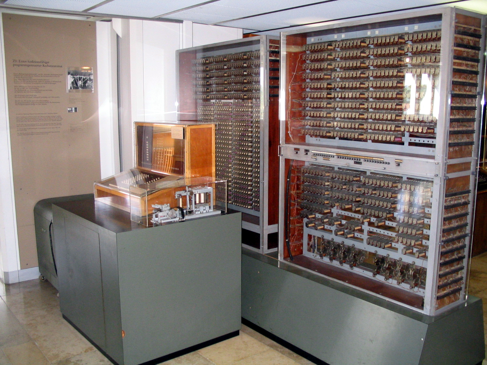

# Transistors & Binary

The core component of a computer is the **transistor**. The core feature of a transistor is that it can be programmed to be either **ON** or **OFF**. 

- **ON** means that it allows electricity to pass through.
- **OFF** means it does not. 

Computers use the number `1` to represent the **ON** state and the number `0` to represent the **OFF** state.

These 1's and 0's are called binary. Everything within a computer is controlled and built off of these **ON (1)** and **OFF (0)** binary states. 

The first "computers" looked like this.



The first "programs" used "punch cards", which told the computer which transistor should be **ON** or **OFF**. If there was a hole in the punch card, that transistor was **ON (1)**; if there was no hole, then it was **OFF (0)**. Then you feed this into the computer, and it runs the operation.


Then things started to get more digital. The first electronic programs behaved in a similar way to the punch cards, but were digitally controlled and looked like this:

```
00010110101011010101010110101010101010101010101010101010010101
```

This sequence of 1's and 0's controlled when these transistors should be in the **ON** or **OFF** state and thus allowed the computer to do something.

A super simplified example of this is your computer screen. Your screen is millions of individual pixels. And each of these can be many different colors using RGB. This means every pixel is actually 3 different (red, green, blue) lights that, when paired together, can make a wide range of colors. 

Each one of these lights can be **ON** or **OFF**. If the red light is programmed to be **ON** and the other two are **OFF**, your pixel will show red. If red and green are on, you make yellow. And if all 3 are on, you make white. You could write a program that tells each of these individual lights to turn on, depending on what color you want. 

Of course, there is a ton of complexity I am skipping over here, but we don't need to go much deeper for learning Dart.

## Quiz

**1. In a computer, what do the binary digits `1` and `0` fundamentally represent?**

- A) `1` represents 'True' and `0` represents 'False'.
- B) `1` represents an 'ON' state (electricity flows) and `0` represents an 'OFF' state.
- C) `1` represents a 'hole' in a punch card and `0` represents 'no hole'.
- D) `1` represents 'Yes' and `0` represents 'No'

<details>
<summary>Answer</summary>

- B) `1` represents an 'ON' state (electricity flows) and `0` represents an 'OFF' state.

</details>

**2. The lesson mentioned that early "programs" used punch cards. If a hole represents `1` (ON) and no hole represents `0` (OFF), what binary sequence does the following punch card row represent?

`[ ● ○ ● ● ○ ● ○ ]`
*(Where `●` is a hole and `○` is no hole)***

- A) `0100101`
- B) `0110101`
- C) `1011010`
- D) `1101011`

<details>
<summary>Answer</summary>

- C) `1011010`

</details>

**3. A single pixel on your screen uses Red, Green, and Blue lights (RGB). To create the color **Magenta**, you need to turn the Red and Blue lights **ON** (`1`), and the Green light **OFF** (`0`).

What binary sequence (in R, G, B order) represents the color Magenta?**

- A) `110`
- B) `011`
- C) `111`
- D) `101`

<details>
<summary>Answer</summary>

- D) `101`

</details>

---

[← Course overview](../../../README.md)
