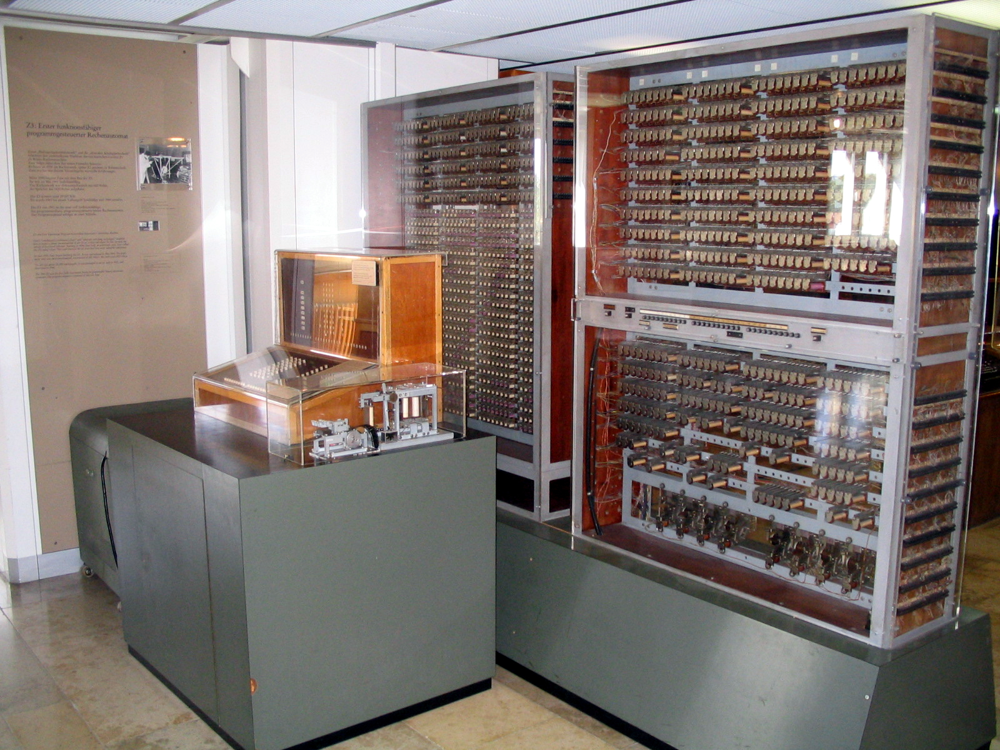

# Binary To Assembly

How do we go from binary to Dart? Because Dart code looks nothing like binary, yet the same logic is used.

The next step after writing binary was to make it more readable for humans to write programs. So assembly was invented. Each assembly instruction is correlated to the binary equivalent. 

```
mov eax, 5
mov ebx, 3
add eax, ebx
```

In this example, `eax` and `ebx` are storage locations (called registers) for that specific computer. It first stores the value 5 into register `eax`, then 3 into register `ebx`. At the end, it adds the values stored in both registers and stores the result back in `eax`.

With assembly code, you still need to understand the computer system fully. It is still quite complicated and tedious. 

So, more abstraction layers were added, like the C programming language. Then, even more layers got added on top of C to give us a higher-level language like Dart.

```dart
var a = 2;
var b = 3;
var c = a + b;
```

While assembly was directly tied to the binary, Dart is not. When writing Dart code, we don't have to remember which memory location we are storing to. We can use variables and operators to write in a human-readable way, similar to how we solve math problems.

But this comes with a bit more complexity for the computer.

In order to run this program on our computer, we must go through another step in the process called "compiling". Only once your program is compiled can your computer run it. 

As you can probably guess, this compiling process turns your pretty, easy-to-read Dart code into machine language, aka binary.

So this is how we got to high-level programming languages like Dart. The code is still doing the very same thing as those first electromechanical computers. But we can program the computer in a way that is easier for humans to understand. 

And that is programming!



## Quiz

**1. What is the primary purpose of "compiling" Dart code?**

- A) A) To make the code more readable for other programmers.
- B) B) To translate the code into machine language that the computer can execute.
- C) C) To automatically add comments and documentation.
- D) D) To run the code directly on the computer without any translation.

<details>
<summary>Answer</summary>

- B) B) To translate the code into machine language that the computer can execute.

</details>

**2. Which of the following represents the highest level of abstraction, making it easiest for humans to write?**

- A) A) Binary `01010111010`
- B) B) Assembly `mov eax, 5`
- C) C) Dart `var a = 5;`
- D) D) Electromechanical switches

<details>
<summary>Answer</summary>

- C) C) Dart `var a = 5;`

</details>

**3. Based on the lesson, what is a key advantage of using a high-level language like Dart instead of assembly language?**

- A) A) Dart programs don't need to be converted to binary before running.
- B) B) Dart allows you to perform math, which is impossible in assembly.
- C) C) You can use simple variables instead of managing specific hardware memory locations (registers).
- D) D) Dart programs always run faster than assembly programs.

<details>
<summary>Answer</summary>

- C) C) You can use simple variables instead of managing specific hardware memory locations (registers).

</details>

---

[← Course overview](../../../README.md)
