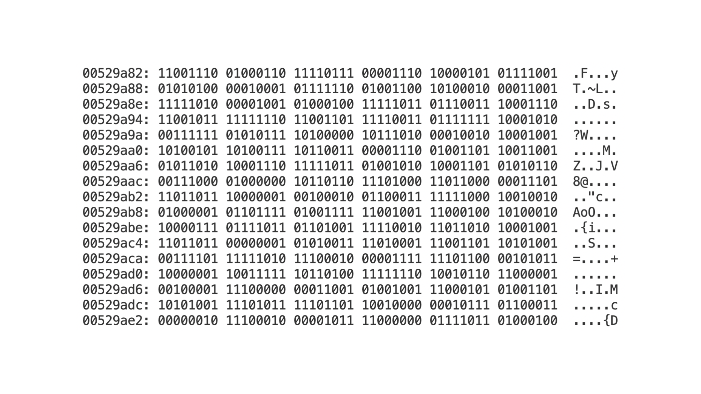

# Dart to Binary

Before we move on from the structure of a Dart program, I want to connect the dots from the **Introduction** module to this module. We started this course talking about how programs are binary code (which is **ON (1)** or **OFF (0)**) that tells the computer what to do. 

We talked about how modern programming languages have many abstraction layers over the direct 1s and 0s, but the core process is still binary. 

So, how does this Dart code get converted to binary so the computer can understand it?

It uses something called a compiler, which translates your code into binary before you run it. This compiler comes packaged with the Dart SDK.

## Dart Compiler

After you have written a Dart program, you use the `dart run` command to run that program while developing.

But, if you want to create a program file that can be used by anyone else, run the `dart compile exe your-file-name.dart` command. 

This will create a `.exe` file that you can send to your friends, and they can run it by calling the file in the terminal like this `./your-file-name.exe` or double-clicking it on Windows.

This is the actual compiled program, and it's compiled into binary.

## Dart Binary

If you're thinking, how do I know this is binary? 

You can run the `xxd -b your-file-name.exe` on Mac, and you will see a long list of things like this.

On the left side, you have the offset (memory address within the file), followed by the actual binary, followed by the ASCII representation of the binary.

> [!info]
> 
> ASCII is a way to represent letters and characters using binary. You can [read more about it here](https://en.wikipedia.org/wiki/ASCII), but we won't need to know this for this course.

## Quiz

**1. What is the primary role of a compiler?**

- A) To run code line by line, translating it just in time for the computer to execute.
- B) To translate the entire program from a high-level language into binary code before the program is run.
- C) To check for spelling and grammar mistakes in your code comments.
- D) To automatically format your code to make it more readable.

Answer

- B) To translate the entire program from a high-level language into binary code before the program is run.

**2. You've written a Dart program named `my_app.dart`. You want to create a standalone executable file that you can share with a friend. Which command should you use?**

- A) dart run my_app.dart
- B) xxd -b my_app.dart
- C) dart compile exe my_app.dart
- D) dart create my_app.dart

Answer

- C) dart compile exe my_app.dart

**3. The `.exe` file produced by the Dart compiler is ultimately made up of what?**

- A) The original Dart source code, just packaged differently.
- B) A list of instructions for an interpreter.
- C) ASCII text representing the program's logic.
- D) Binary code (1s and 0s) that the computer's processor can execute directly.

Answer

- D) Binary code (1s and 0s) that the computer's processor can execute directly.

---

[← Course overview](../../../README.md)
