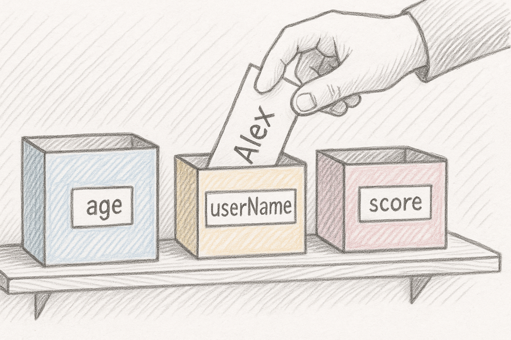

# Why use a Variable?

I want to go a little deeper into variables, because they are such a core first concept to really understand. 

Why do we need to use variables?

Variables in Dart act like labeled boxes where you can store information, such as numbers, words, or other data, that you want your program to use. Imagine you have a set of boxes, each with a sticker that tells you what's inside. You can open the box, see what’s there, swap its contents, and use what’s inside whenever you need it.

## The Box Analogy

Picture your computer’s memory as a large set of shelves, and each variable is a box you place on a shelf. Each box has a label, like `userName` or `age`. When you need to use the information, you simply look at the label and open the right box.

- If you want to greet someone by name, you don’t have to remember their name every time. You just look inside the `userName` box.
- If the value changes (say, the user updates their name), you simply replace what's inside the box without getting a new one.



## Reusing Values

Suppose you want to use someone's name in several places. Instead of writing "Alex" everywhere, you put "Alex" in a box labeled `userName`. Whenever you need the name, you just peek into the box.

```dart
var userName = 'Alex';
print('Hello, $userName!');
print('$userName, your order is ready.');
```

If "Alex" changes his name to "Sam", you only need to swap out the slip of paper in the `userName` box. All parts of your program using that box now see the new name.

## Storing Input

Sometimes, you don’t know what will go in your box until the program is running. Maybe you ask the user for their age. As soon as they answer, you write the value on a slip and drop it into the `age` box.

```dart
var age = 25; // This value could come from user input
print('You are $age years old.');
```

Your program can now use what's in the `age` box anywhere. No need to ask again.

## Managing Changing Information

You can take out the contents of a box and put something new in at any time. For example:

```dart
var score = 0;    // The game starts, box contains 0
score = 10;       // Player earns points, slip in the box is replaced with 10
score = score + 5; // More points, now the box contains 15
print('Your score: $score');
```

This is much easier than keeping track of scores in your head or writing numbers everywhere.

## Making Code Clear

Good labels on your boxes help you and others understand what each value means. Compare:

```dart
print('You have 3 items in your cart.'); // What does 3 mean?
```

Versus:

```dart
var itemsInCart = 3;
print('You have $itemsInCart items in your cart.');
```

The second version uses a clearly labeled box, making your code easy to read and change.

## Performing Calculations

You can use several boxes together, combine their contents, and store new results in another box:

```dart
var price = 10;
var quantity = 5;
var total = price * quantity; // total is a new box holding the result
print('Total cost: $total');
```

You can always update what’s inside any box without rewriting your whole program.


## Summary Table: What Boxes (Variables) Do for You

| What You Get From Variables | How the Box Analogy Helps            |
|----------------------------|--------------------------------------|
| Store information          | Put data in a labeled box            |
| Reuse data easily          | Use the box label wherever needed    |
| Update data anytime        | Swap out the slip in the box         |
| Clear, readable code       | Good labels make meaning obvious     |
| Perform calculations       | Combine boxes for new results        |

In Dart, variables are your labeled boxes: they let you store, retrieve, and update information throughout your program, making your code more organized and powerful.

## Assignment

Create a Dart program to help the potion master manage their inventory.

Start by declaring variables to store the number of potions and their cost.

Then, calculate the total price, update the potion count when more potions are purchased, and recalculate the total to include the new purchase.

## Challenge

Code: [starter code](code/initial) · [solution](code/solution)

Start in `bin/main.dart`. Tests: `test/main_test.dart`.

---

[← Course overview](../../../README.md)
