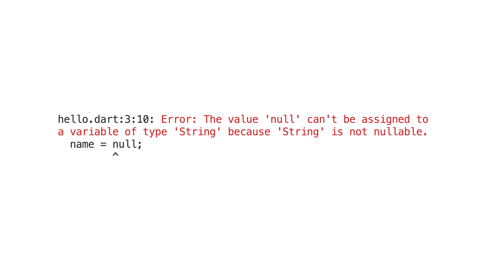
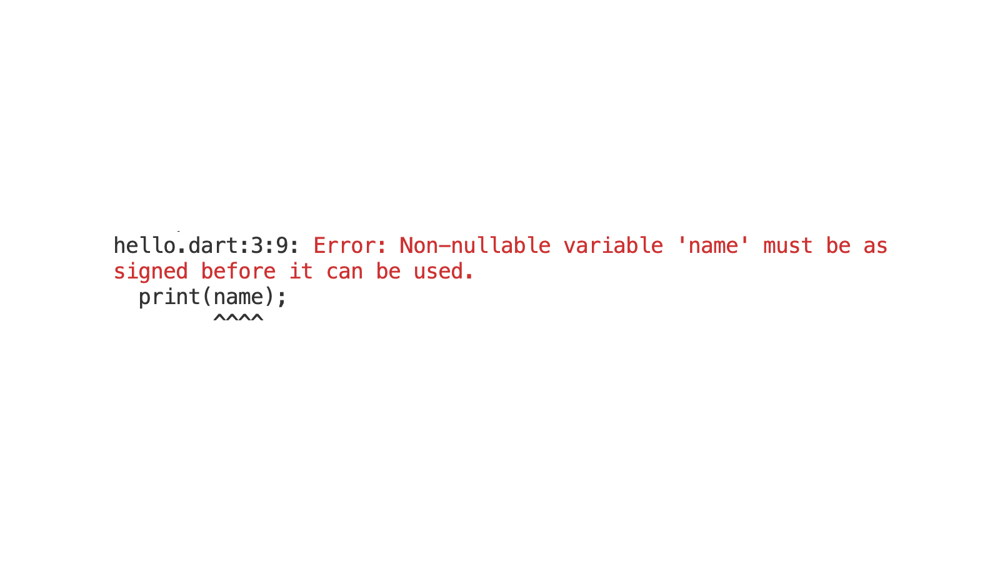

# Nullabe & Non-Nullable Variables

The goal for null safety in Dart is to make sure that we can't have null values in our code unless we explicitly want them.

With my current code, if I try to assign null to a `String` variable, I get an error.

```dart
void main() {
  String name = 'Tadas';
  name = null;
  print(name);
}
```



The error message tells us that a value of type 'null' can't be assigned to a variable of type 'String'. This means that the name variable is non-nullable.

## Nullable Variables

If we want to create a nullable variable, we need to explicitly tell Dart that we want this variable to be nullable. We can do this by adding a `?` to the end of the variable's type.

```dart
void main() {
  String? name = 'Tadas';
  name = null;
  print(name);
}
```

This time, there were no errors.

Adding the `?` tells Dart that this variable is nullable, so it can have a value of `null`.

There are many instances in programming where we want to have nullable variables. For example, if we are creating an application where the user can log in, we may want the variable holding the user's name to be null since we don't know the user's name until they log in.

```dart
void main() {
  String? name = null;
  // user logs in
  name = 'Tadas';
}
```

## Null Safety

So, by default, all variables in Dart are non-nullable. Thus, we must assign a value to them before using them. This is why we get an error in the code below.

```dart
void main() {
  String name;
  print(name);
}
```



This error is actually a little different than the one we got when we tried to assign null to a non-nullable variable.

To fix this, we need to initialize the variable with a value.

```dart
void main() {
  String name = '';
  print(name);
}
```

## Quiz

**1. Which of the following correctly declares a variable named `middleName` that can hold either a `String` or a `null` value?**

- A) `String middleName?;`
- B) `nullable String middleName;`
- C) `String? middleName;`
- D) `String middleName = null;`

<details>
<summary>Answer</summary>

- C) `String? middleName;`

</details>

**2. Review the code below. Why will it cause an error?

```dart
void main() {
  String greeting = 'Hello';
  greeting = null;
}
```**

- A) Because `null` is not a valid value in Dart.
- B) Because the `greeting` variable was declared using `String` instead of `var`.
- C) Because variables of type `String` are non-nullable by default and cannot be assigned `null`.
- D) Because the `greeting` variable was already assigned a value ('Hello').

<details>
<summary>Answer</summary>

- C) Because variables of type `String` are non-nullable by default and cannot be assigned `null`.

</details>

**3. What is the problem with the following code?

```dart
void main() {
  String name;
  print(name);
}
```**

- A) The `print` function cannot be used with a `String`.
- B) The non-nullable variable `name` must be assigned a value before it can be used.
- C) The variable `name` is nullable and cannot be printed directly.
- D) The variable `name` should have been declared with the `final` keyword.

<details>
<summary>Answer</summary>

- B) The non-nullable variable `name` must be assigned a value before it can be used.

</details>

---

[← Course overview](../../../README.md)
