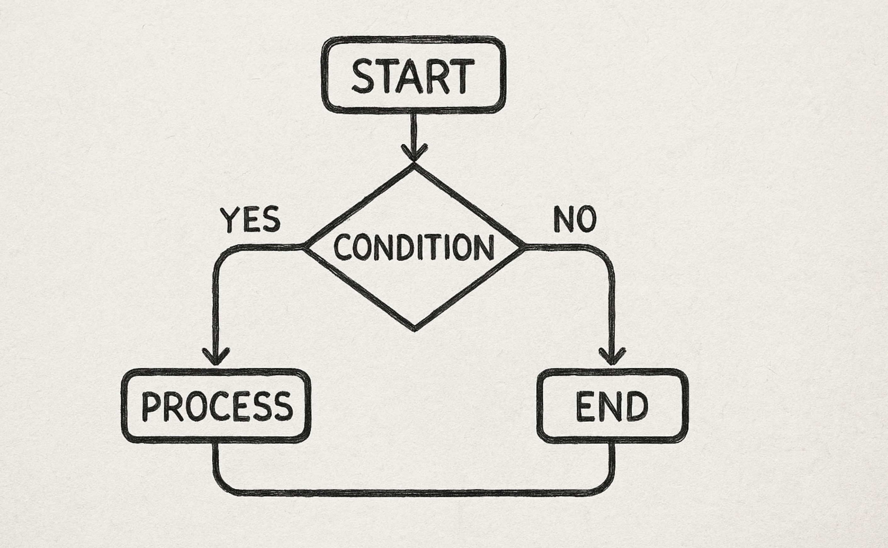

# What is Control Flow?

Control flow is the order in which statements are executed in a program. Until now, our programs have been pretty straightforward, and the statements were executed one after the other.

However, as your programs become more complex, you will want to change the order of execution based on certain conditions. For example, if a user enters the wrong password, you don't want to let them into your website. If a user enters a negative number, you want to show an error message.

You can control the flow of your program using conditional statements and loops, which we will discuss in the following lessons.

## Quiz

**1. What is the best definition of "control flow"?**

- A) The speed at which a program executes its instructions.
- B) The order in which a program's statements are executed.
- C) The way a program stores variables in memory.
- D) The process of turning source code into a runnable program.

Answer

- B) The order in which a program's statements are executed.

**2. Which of the following scenarios is the BEST example of needing to alter a program's control flow?**

- A) A program that calculates the sum of 5 and 10 and prints the result.
- B) A program that asks for a user's name and then prints a greeting with that name.
- C) A program that checks if a user is over 18 and shows a different message depending on their age.
- D) A program that prints the first three lines of a song.

Answer

- C) A program that checks if a user is over 18 and shows a different message depending on their age.

---

[← Course overview](../../../README.md)
