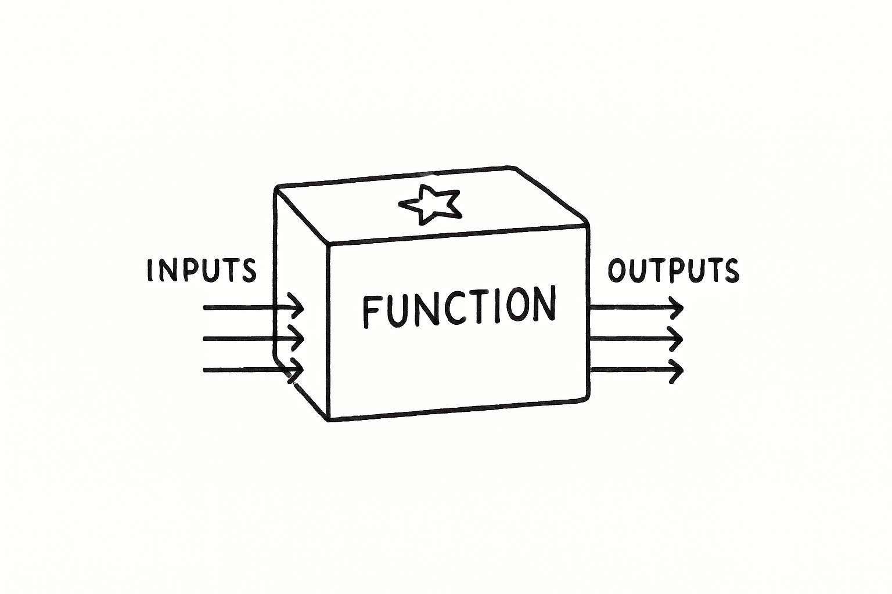

# What is a Function?

Functions are the most important concept in programming.

You have actually already used a few functions in Dart.

```dart
void main() {
  print("Hello World!");
  int number = int.parse('1');
}
```

In the code above, we used the built-in `print()` and `int.parse()` functions.

> [!note]
>
> Technically `int.parse()` is a method. The difference is that the `parse()` belongs to the *object* `int`. We will go deeper into this in the Object-Oriented Programming module, but they serve the same purpose.

## What is a Function?

You can think of a function as a magic box. You give the magic box some inputs, it does some kind of magic, and then returns an output.



You don't need to know what magic happens inside the box. You just need to know what inputs to give and what output to expect.

The `print()` function has no outputs. This is called a `void` function. We give the `print()` function a String as an input, and inside the function, it does some magic (in this case shows your String in the terminal).

The `int.parse()` does give us an output. It takes a String as input, and the output is an integer. We can use that integer to assign it to a variable.

Functions become very powerful because you can also create your own.

## Quiz

**1. According to the "magic box" analogy in the lesson, what is the best description of a function?**

- A) A container for storing a single piece of data, like a number or text.
- B) A statement that allows a program to make a decision, like an `if` statement.
- C) A reusable piece of code that can take inputs, perform a task, and return an output.
- D) A way to repeat a block of code multiple times, like a `for` loop.

<details>
<summary>Answer</summary>

- C) A reusable piece of code that can take inputs, perform a task, and return an output.

</details>

**2. The lesson mentions that the built-in `print()` function is a `void` function. What does this mean?**

- A) The function performs an action but does not return an output value.
- B) The function does not accept any inputs.
- C) The function is empty and does not perform any action.
- D) The function has an error and cannot be used.

<details>
<summary>Answer</summary>

- A) The function performs an action but does not return an output value.

</details>

**3. Consider the following line of code from the lesson: `int number = int.parse('1');`. What is the **input** to the `int.parse()` function?**

- A) The variable `number`.
- B) The integer `1`.
- C) The `int` data type.
- D) The string `'1'`.

<details>
<summary>Answer</summary>

- D) The string `'1'`.

</details>

---

[← Course overview](../../../README.md)
