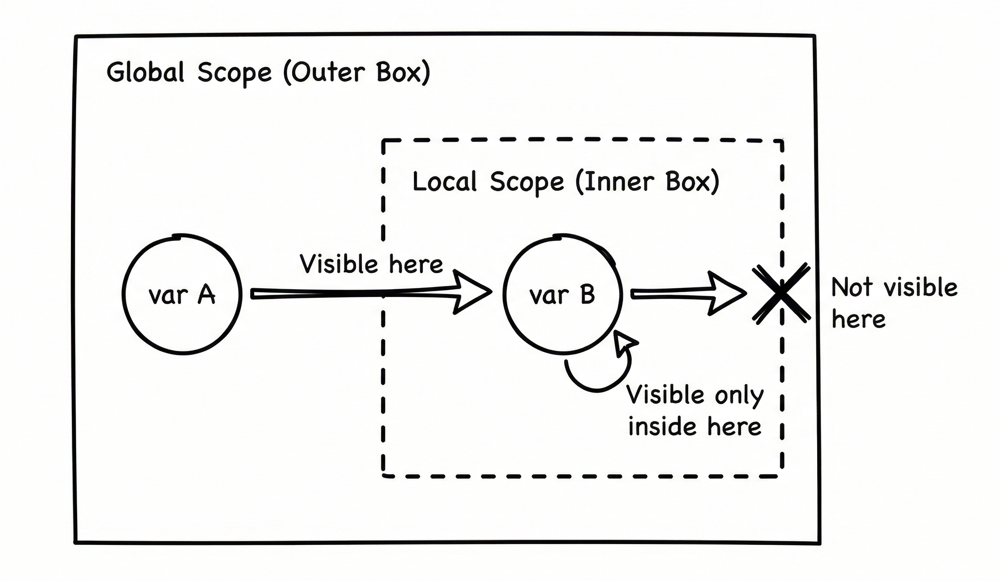

# Understanding Scope

When we define a variable inside a function, it can only be used within that function.

```dart
void main() {
  var name = 'Kyle';
  print('Hello $name');

  differentFunction();
}

void differentFunction() {
  print(name);
}
```

In this code, we defined a variable called `name` inside the main function and tried to use it inside the `printName` function. You will see an error in the code because the `differentFunction` function does not know about the `name` variable (unless we pass it in).

The `name` variable is only accessible within the `main` function. This concept is called **scope**.



The scope is the portion of the code where a variable can be accessed. In the above example, the `name` variable can only be accessed within the scope of the `main` function.

If you want to use a variable within multiple functions, you must declare it outside the functions.

```dart
var name = 'Kyle';

void main() {
  print('Hello $name');
  printName();
}

void printName() {
  print(name);
}
```

Now, this code works because the `name` variable is in the scope of the entire application and thus accessible within both functions.

The scope of a variable is very important to understand because it can lead to many bugs if you are not careful. You should try to keep the scope of a variable as small as possible and only make it accessible where it is needed.

You will learn more about scope as we dive into the next section.

## Quiz

**1. Which of the following best describes the concept of "scope" in Dart?**

- A) A) The data type of a variable, such as `String` or `int`.
- B) B) The process of assigning an initial value to a variable.
- C) C) The portion of the code where a variable can be accessed.
- D) D) A special type of function that does not return a value.

<details>
<summary>Answer</summary>

- C) C) The portion of the code where a variable can be accessed.

</details>

**2. Review the following Dart code:


```dart
void main() {
  greetUser();
  print(message); 
}

void greetUser() {
  var message = 'Hello from greetUser!';
  print(message);
}
```

What will happen when you try to run this code?**

- A) A) It will print "Hello from greetUser!" twice.
- B) B) It will cause an error because `message` is not accessible in `main`.
- C) C) It will print "Hello from greetUser!" and then print `null`.
- D) D) It will only print "Hello from greetUser!" and then exit successfully.

<details>
<summary>Answer</summary>

- B) B) It will cause an error because `message` is not accessible in `main`.

</details>

**3. According to the lesson, what is the recommended best practice for managing a variable's scope?**

- A) A) Always define variables outside of any function to ensure they can be accessed everywhere.
- B) B) Pass every variable as a parameter to every function.
- C) C) Use the `final` keyword for all variables to lock their scope.
- D) D) Keep the scope of a variable as small as possible, only making it accessible where needed.

<details>
<summary>Answer</summary>

- D) D) Keep the scope of a variable as small as possible, only making it accessible where needed.

</details>

---

[← Course overview](../../../README.md)
