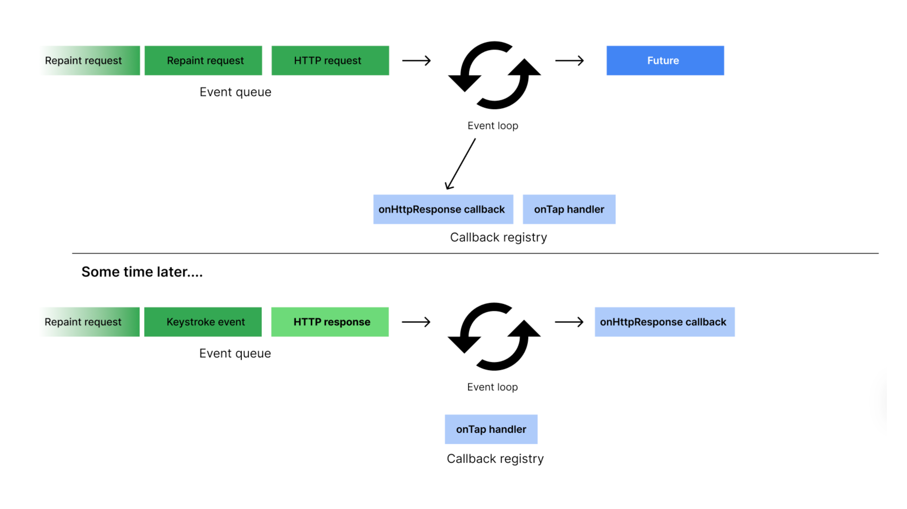

# The Event Loop

Dart is a single-threaded language. This means that it can only execute one instruction at a time on a single thread. But what if we want to run multiple tasks concurrently, or if we have a task we want to run in the background? This is where the Event Loop comes in.

The Event Loop is the system that allows Dart to run multiple tasks. Not exactly at the same time, but using a queue system that stores all the tasks that need to be executed, and Dart will continue picking up the next task in the queue and executing it one by one until the queue is empty.

This allows us to run code asynchronously. 

Asynchronous programming is a programming paradigm that enables us to run code without waiting for the current task to finish. Remember that computers can only do one instruction at a time on a thread. So if we always wait for the previous task to finish, your program will be very slow.

Imagine that you have a function that fetches data from a database. If you must wait for this function to finish before executing the next one, it will take a very long time for your app to display anything. The rest of your program will freeze while it is waiting for the fetch function to finish.

But with asynchronous programming, you can perform other tasks while waiting for the fetch function to finish, like rendering the UI for the user, displaying a loading indicator, or even running other functions.

## Quiz

**1. What does it mean for Dart to be a "single-threaded" language?**

- A) It can execute multiple instructions at the exact same time.
- B) It can only have one `main()` function in a program.
- C) It can only run on computers with a single-core processor.
- D) It can only execute one instruction at a time.

Answer

- D) It can only execute one instruction at a time.

**2. What is the primary role of the Event Loop in Dart?**

- A) To execute multiple tasks in parallel on different threads.
- B) To manage a queue of tasks so they can be run concurrently without blocking the program.
- C) To check for syntax errors in your code before it runs.
- D) To store variables and function definitions in memory.

Answer

- B) To manage a queue of tasks so they can be run concurrently without blocking the program.

**3. Imagine your app needs to download an image from the internet. Why is it beneficial to perform this task asynchronously?**

- A) It makes the internet connection faster, so the image downloads in less time.
- B) It prevents the user interface from becoming unresponsive while the image is downloading.
- C) It guarantees the downloaded image will not have any errors.
- D) It reduces the memory used by the program during the download.

Answer

- B) It prevents the user interface from becoming unresponsive while the image is downloading.

---

[← Course overview](../../../README.md)
