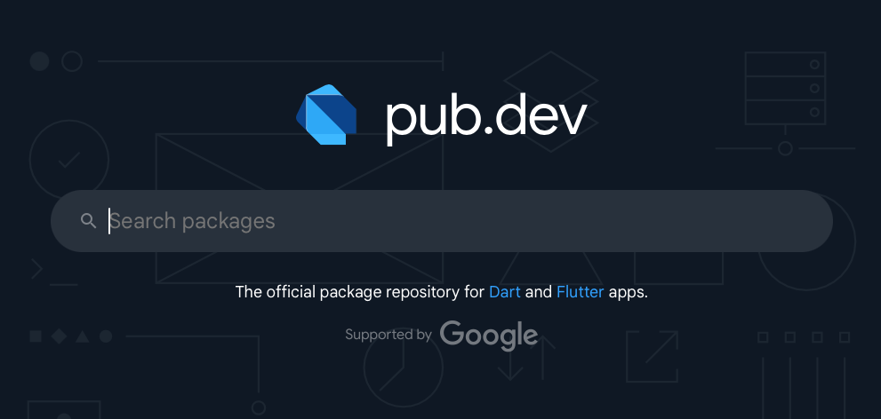

# Dependencies

There is a massive community of developers building with Flutter, and a massive ecosystem of "packages". Packages are open source code modules that can be uploaded to pub.dev.

## pub.dev

pub.dev is Dart's (and Flutter's) official package repository. It's where you can discover, publish and share your packages for others to use.



Any package that is hosted on pub.dev can be added to your project with one line in the `pubspec.yaml` file. Once a package is within you code base it is now called a "dependency". You can still call it a package, everybody will still understand what you are talking about. But once it is in your project your project now "depends" on this "dependency".

To add a package to your project, you must add the package name under the dependencies section alongside the Flutter dependency.

```yaml title="pubspec.yaml" {4}
dependencies:
  flutter:
    sdk: flutter
  chucknorris: ^1.0.0
```

There are a ton of packages that cover everything from UI components to layouts, navigation, state management, APIs, and even Chuck Norris jokes.


### Developer Dependencies

There is also a section in the `pubspec.yaml` where you can add `dev_dependencies`. These are dependencies that are required only during the development and testing phase of a project, not in the final production build.

```yaml
dev_dependencies:
  flutter_test:
    sdk: flutter
```

Dev dependencies are not bundled into the compiled application, so they don’t affect the app’s size or performance in production.

## Quiz

**1. When does a package become a dependency?**

- A) When it's hosted on pub.dev
- B) When it's added to the pubspec.yaml file
- C) Whenever it's used in your project
- D) They mean the same thing

<details>
<summary>Answer</summary>

- B) When it's added to the pubspec.yaml file

</details>

**2. Which of these would make sense as a dev dependency?**

- A) Integration with a Database
- B) Generating code that will be used in the app
- C) A confetti animation
- D) Retrieving the weather data

<details>
<summary>Answer</summary>

- B) Generating code that will be used in the app

</details>

---

[← Course overview](../../../README.md)
