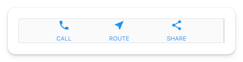
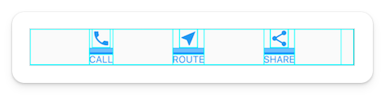

# What is a Widget?

The Flutter Framework centers around the concept of a **Widget**.

A widget is the building block used to create your application. It's a blueprint that tells Flutter (and eventually your device) how you want your application to look and behave.

A house needs a variety of building blocks to create a fully functioning shelter. For example, you need walls, doors, windows, roof, heating, kitchen, etc.

Applications also need a variety of building blocks to create a fully functioning app. These building blocks are called widgets. We need a scaffolding widget to hold the elements on the page, input widgets to let the user interact with it, visual widgets to show the user something, etc.

A common saying in the Flutter community is that "everything is a widget". While there is some nuance to that, it is generally true. The image below has 14 developer-facing widgets. What I mean by "developer-facing" is that those widgets can be composed by others behind the scenes, but from our perspective, we only see these 14 in our code.

The first is a `Row` widget, and then there are 3 `Column` widgets. Each column has an `Icon` widget and a `Text` widget. This is what it looks like with each widget highlighted.

There is a <a href="https://docs.flutter.dev/reference/widgets" target="_blank">massive library</a> of these widgets, and they can do everything from detecting a touch input to setting your layout to navigating within the app. The sheer number of widgets seems daunting initially, but don't worry. To build basic apps, you won't need to use most of them; you can add more fancy ones as you need them.

> Note: After working with Flutter, you will start remembering the ones you commonly use, but even after five years, I still need to look up widgets for very specific use cases.

## Quiz

**1. Which of the following widgets was not in the image?**

- A) Row
- B) Column
- C) Text
- D) Image

Answer

- D) Image

---

[← Course overview](../../../README.md)
