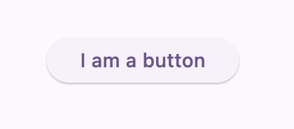
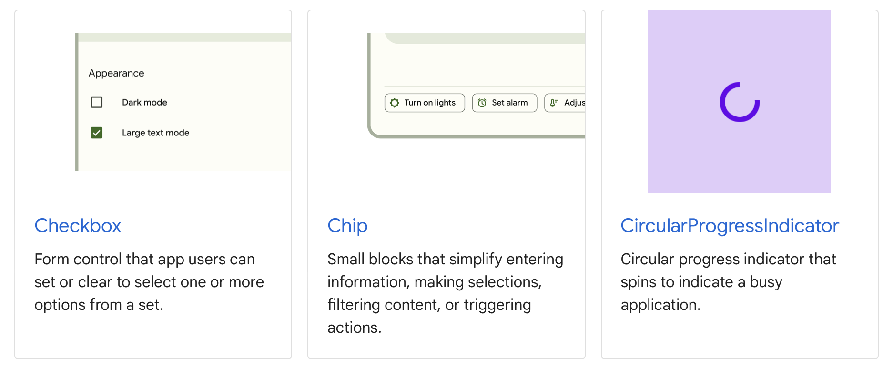

# Simple Widgets

First, we will cover the User Interface (UI) widgets because they are the simplest. The UI layer is where most of the magic of Flutter is.

I use the term **Simple Widgets** for this lesson because "everything in Flutter is a widget", including widgets that pass data down, layout widgets, and animation widgets.

The simplest to understand and visualize are widgets that represent UI components.

Here's what a button widget looks like:

```dart
ElevatedButton(
  onPressed: () {},
  child: Text('I am a button'),
)
```



There are three types of button widgets in Flutter.

1. `ElevatedButton` - A button with a shadow that looks elevated from the screen.
2. `TextButton` - A button that only displays text.
3. `OutlinedButton` - A button with a border.

There are widgets for displaying text (`Text`), images (`Image`), icons (`Icon`), and almost everything else you can think of.

If it is a commonly used component, Flutter will likely already have a widget.



You can look at the complete list of widgets [here](https://docs.flutter.dev/development/ui/widgets). This list is massive, but don't worry about memorizing it. I don't know half of them, but when building a widget in your application, you should google or ChatGPT whether that widget already exists.

## Assignment

Add an `ElevatedButton` above the `TextButton` widget.

## Challenge

Code: [starter code](code/initial) · [solution](code/solution)

Start in `lib/widgets.dart`. Tests: `test/widget_test.dart`.

---

[← Course overview](../../../README.md)
