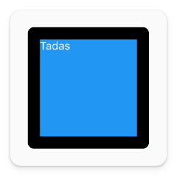

# Configuring a Widget

You can configure your widgets to change how they look and act. For example, the `Text` widget has configurations to change the styling, and we do this through a property called `style`.

```dart
Text(
    "Hello",
    style: TextStyle(color: Colors.white),
)
```

The `AppBar` widget has a configuration to change the color using the `backgroundColor` property.

```dart
AppBar(
    backgroundColor: Colors.blue,
    title: const Text("Title"),
)
```

The `Container` widget is _extra_ configurable. You can do things like this:

```dart
Container(
    height: 200,
    width: 200,
    margin: const EdgeInsets.all(20),
    decoration: BoxDecoration(
        border: Border.all(color: Colors.black, width: 20),
        borderRadius: BorderRadius.circular(10),
        color: Colors.blue,
    ),
    child: const Text(
        "Tadas",
        style: TextStyle(color: Colors.white),
    ),
)
```

And this takes a widget that, without any configuration, would not even be visible to this blue square with a black border and some text:



You're a widget designer now!

## Assignment

Configure the `Container` widget to

- display your name
- have a width of 400px
- change the border width to 3px
- add a padding for the text of 20px

## Challenge

Code: [starter code](code/initial) · [solution](code/solution)

Start in `lib/configure.dart`. Tests: `test/configure_test.dart`.

---

[← Course overview](../../../README.md)
