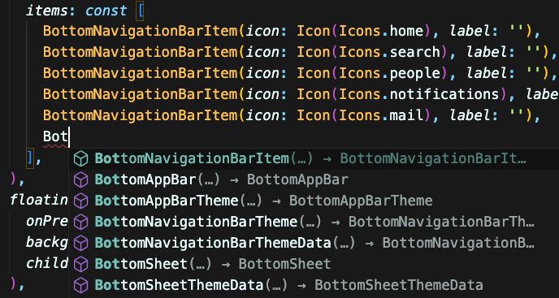
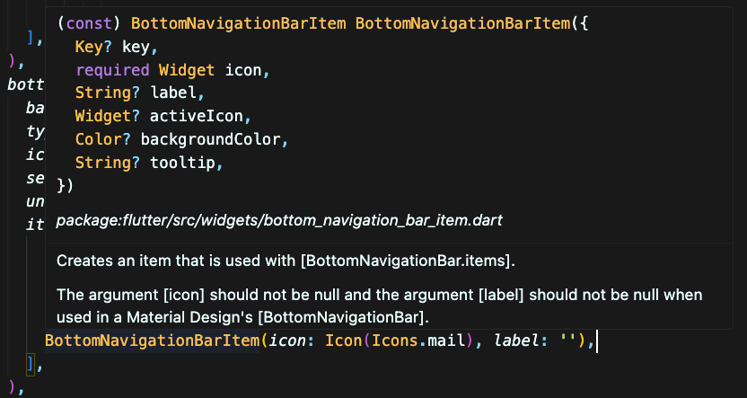

# How to Find the Right Widget

We covered a lot of widgets. Sadly, we barely scratched the surface.

I remember feeling overwhelmed when I first started working with Flutter. So, I want to reassure you that it's not as bad as it looks.

I remember only 5% of widgets, if not less. And I'm doing just fine.

But seriously, it's impossible to memorize all the widgets and all the fields for those widgets. And there is no reason to.

## Steps to find a widget

### Step 1: Start typing

Hopefully, you are using an editor with IntelliSense like VSCode. Sometimes, I know the first part of the widget name, and I start typing, and Intellisense shows it. Once I see the widget, some tiny neurons will get triggered, and I will remember that it is the right widget. For example, I might forget what the widget in the `BottomNavigationBar` is called, so I'll start typing. Since most Flutter widgets are named exactly what they do, I will see `BottomNavigationBarItem`, which will be exactly what I need.

### Step 2: Guess

If I have no idea, sometimes I guess. Start typing a widget name that might make sense; then, you can hover over the widget and read the description. Depending on the day, I will probably try to guess it at least three times.

### Step 3: Search

Sometimes, I don't know what I need. Depending on your preference, you can:

1. Try to find it using the [Flutter Widget Catalog](https://docs.flutter.dev/ui/widgets).
2. Googling what you want to do.
3. (New) Ask AI. Currently, Claude Sonnet 4 is the best for Flutter as of 01/08/2025.

### Step 4: Package

If you are still looking for it, the widget might be too specific for your use case. This last step depends on how much time you have. If you have all of it, you should build it yourself. It will be fun. But if you need to build quickly, a ton of packages have the widget you need. You can search for them on [pub.dev](https://pub.dev). If you can't find it there, then you will have to build it yourself.

## Quiz

**1. What is the recommended first step when looking for a Flutter widget?**

- A) Use IDE IntelliSense and start typing
- B) Search pub.dev for packages
- C) Check the Flutter Widget Catalog
- D) Ask on Stack Overflow

Answer

- A) Use IDE IntelliSense and start typing

**2. When should you consider creating a custom widget?**

- A) Immediately when you can't find an existing widget
- B) Only after exhausting all search options and finding no suitable package
- C) Never, there's always an existing widget
- D) Only for simple UI elements

Answer

- B) Only after exhausting all search options and finding no suitable package

---

[← Course overview](../../../README.md)
