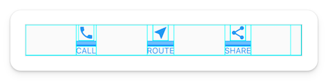
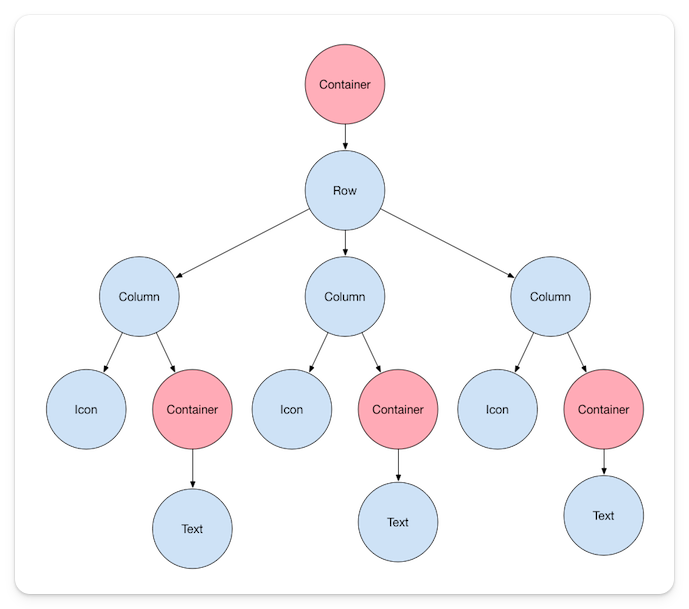

# Widget Tree

To build out your complete application, you need to organize these widgets in a tree-like structure called a "Widget Tree," which becomes the structure of your whole application. Take the previous example with the highlighted row of icons and texts.

The widget tree for this layout would look like this:

You start with wrapping the whole thing with a `Container` widget, followed by a `Row` where we will put all those icons. Each item in the row will have a `Column` widget with an `Icon` stacked on top of a `Text` widget within another `Container`. This widget tree is the blueprint used to render our row of icons.

This is a fundamental concept to understand since this is how your Flutter app is built. You write the code to create this widget tree, and Flutter uses that widget tree as a blueprint to render your application to all these devices. As you develop in Flutter, you will run into problems with state management, layouts, or other complex issues. By understanding the widget tree, you can work through it and eventually solve them.

## Quiz

**1. What is the primary purpose of a Widget Tree in Flutter?**

- A) To organize code files in a project
- B) To create the structure and hierarchy of the application
- C) To manage state in the application
- D) To handle user interactions

Answer

- B) To create the structure and hierarchy of the application

**2. In a Widget Tree, how are widgets typically organized?**

- A) Randomly placed wherever they fit
- B) In a horizontal line only
- C) In a tree-like structure with parent-child relationships
- D) In alphabetical order

Answer

- C) In a tree-like structure with parent-child relationships

**3. What is the correct widget hierarchy for the image in this lesson?**

- A) Row → Text → Icon → Column
- B) Container → Row → Column → (Icon + Text)
- C) Column → Container → Row → Icon
- D) Icon → Text → Row → Container

Answer

- B) Container → Row → Column → (Icon + Text)

**4. What role does the Widget Tree serve in Flutter's rendering process?**

- A) It's only used for documentation purposes
- B) It serves as a blueprint for rendering the application UI
- C) It manages the application's database
- D) It handles network requests

Answer

- B) It serves as a blueprint for rendering the application UI

---

[← Course overview](../../../README.md)
