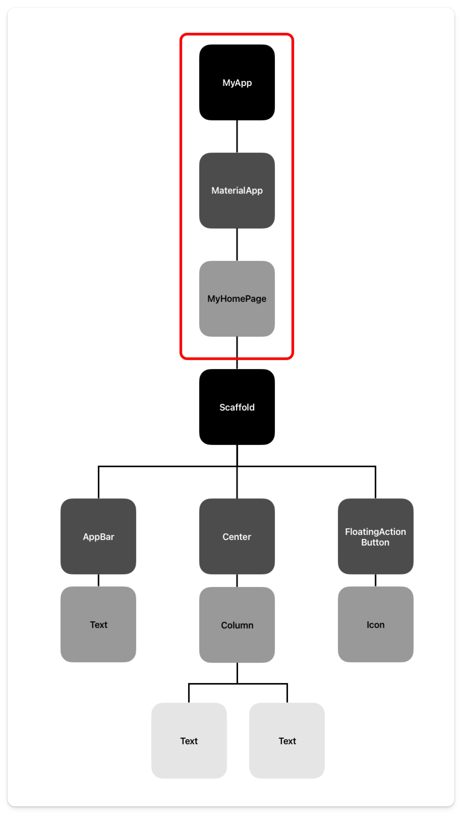

# Starter Widget Tree

When creating a new app, your starter code is a counter application. Now that we have covered some basic fundamental concepts, we can walk through this code.

```dart collapse={23-67}
import 'package:flutter/material.dart';

void main() {
  runApp(const MyApp());
}

class MyApp extends StatelessWidget {
  const MyApp({super.key});

  @override
  Widget build(BuildContext context) {
    return MaterialApp(
      title: 'Flutter Demo',
      theme: ThemeData(
        colorScheme: ColorScheme.fromSeed(seedColor: Colors.deepPurple),
      ),
      home: const MyHomePage(title: 'Flutter Demo Home Page'),
    );
  }
}

class MyHomePage extends StatefulWidget {
  const MyHomePage({super.key, required this.title});

  final String title;

  @override
  State<MyHomePage> createState() => _MyHomePageState();
}

class _MyHomePageState extends State<MyHomePage> {
  int _counter = 0;

  void _incrementCounter() {
    setState(() {
      _counter++;
    });
  }

  @override
  Widget build(BuildContext context) {
    return Scaffold(
      appBar: AppBar(
        backgroundColor: Theme.of(context).colorScheme.inversePrimary,
        title: Text(widget.title),
      ),
      body: Center(
        child: Column(
          mainAxisAlignment: MainAxisAlignment.center,
          children: <Widget>[
            const Text(
              'You have pushed the button this many times:',
            ),
            Text(
              '$_counter',
              style: Theme.of(context).textTheme.headlineMedium,
            ),
          ],
        ),
      ),
      floatingActionButton: FloatingActionButton(
        onPressed: _incrementCounter,
        tooltip: 'Increment',
        child: const Icon(Icons.add),
      ),
    );
  }
}
```

The entry point for every application is the `main` function. Within that function, we call another function, `runApp`.

Remember, our whole app is just a massive widget tree. Our top-level widget is called `MyApp`. And by passing in this widget, we pass in the whole widget tree and, thus, the entire app. Then, the `runApp` runs the app.

## MaterialApp

Within the `MyApp` widget, we need to create the entire application. If you take a step back and think about everything that needs to happen for an application to be complete, there is a lot. You need theming, navigation, localization, defining a home screen, etc.

Flutter provides a widget called `MaterialApp` that gives you all the baseline functions you need for a complete application.

> Material is the Android design system, and the `MaterialApp` widget gives our app a default Android-y look and feel.

In the `MaterialApp` widget, we define the home page as `MyHomePage`, and this page will show up first whenever we run our application.



## Home Page

Once we're on the home page, it's all visual widgets. The `Scaffold` widget holds all the user interface elements on the screen. It is the background layer on which every user interface element is built.

I have to commend the Flutter team for naming widgets. Most widgets are named after exactly what they do.

The rest of the widgets are exactly what they sound like. We have an `AppBar` widget with a `Text` widget. The main section is wrapped in a `Center` widget, with two texts in a `Column` widget. Lastly, we have a `FloatingActionButton` widget at the bottom right with an `Icon` widget inside. You can guess what most of these widgets do.

Each widget has either one `child` or multiple `children` that can be passed to create the widget tree.

## Quiz

**1. What is the entry point for a Flutter application?**

- A) MaterialApp
- B) MyApp
- C) main
- D) runApp

<details>
<summary>Answer</summary>

- C) main

</details>

**2. What is the purpose of the Scaffold widget?**

- A) To provide theming for the app
- B) To hold all UI elements on the screen
- C) To manage state
- D) To create animations

<details>
<summary>Answer</summary>

- B) To hold all UI elements on the screen

</details>

**3. What does MaterialApp provide to your application?**

- A) Only Android styling
- B) Only navigation capabilities
- C) Baseline functions including theming, navigation, and localization
- D) Only state management

<details>
<summary>Answer</summary>

- C) Baseline functions including theming, navigation, and localization

</details>

---

[← Course overview](../../../README.md)
