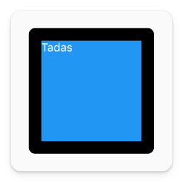

# Container

There is one specific widget I want to cover in-depth: `Container`.

`Container` is the most used widget because it is so versatile. If you've used HTML, this is similar to a `<div>` element.

By default, it doesn't display anything. It's like a box on the screen with no size.

```dart
Container()
```

But you can customize it as much as you want, including having a background color, border, margin, padding, width, height, etc.

```dart
Container(
  height: 200,
  width: 200,
  margin: const EdgeInsets.all(20),
  decoration: BoxDecoration(
    border: Border.all(color: Colors.black, width: 20),
    borderRadius: BorderRadius.circular(10),
    color: Colors.blue,
    ),
  child: const Text(
    "Tadas",
    style: TextStyle(color: Colors.white),
  ),
)
```



It's the most flexible and most customizable widget.

## Inside the Framework

`Container` is so flexible because, under the hood, it is a bunch of singular function widgets combined to make one flexible widget.

This is a simplified version of the build method of the `Container` widget within the Flutter framework code. The build method checks each property and then creates a chain of widgets.

```dart title="container.dart"
Widget build(BuildContext context) {
  Widget? current = child;

  if (color != null) {
    current = ColoredBox(color: color!, child: current);
  }

  if (decoration != null) {
    current = DecoratedBox(decoration: decoration!, child: current);
  }

  if (constraints != null) {
    current = ConstrainedBox(constraints: constraints!, child: current);
  }

  if (margin != null) {
    current = Padding(padding: margin!, child: current);
  }

  if (transform != null) {
    current = Transform(transform: transform!, alignment: transformAlignment, child: current);
  }

  return current!;
}
```

So, if you pass a `Container` with a `color` and `padding`, under the hood it will create a chain of widgets.

```dart
Container(
  color: Colors.blue,
  padding: const EdgeInsets.all(20),
)

// Under the hood it will create a chain of widgets like this:
ColoredBox(
  color: Colors.blue,
  child: Padding(
    padding: const EdgeInsets.all(20),
    child: child,
  ),
)
```

You don't necessarily need to know how the Flutter framework functions under the hood to use it, but understanding the tooling will help you become a better developer and solve problems more efficiently.

So expect some more of this.

### Assignment

Create the same container we had in the "Configuring Widgets" lesson. Here's what it needs to look like:

- 200px tall
- 400px wide
- A blue background
- A white text label with your name
- 20px padding on all sides
- 20px margin on all sides
- A black border with a width of 3px
- A border radius of 10px

## Challenge

Code: [starter code](code/initial) · [solution](code/solution)

Start in `lib/container.dart`. Tests: `test/container_test.dart`.

---

[← Course overview](../../../README.md)
