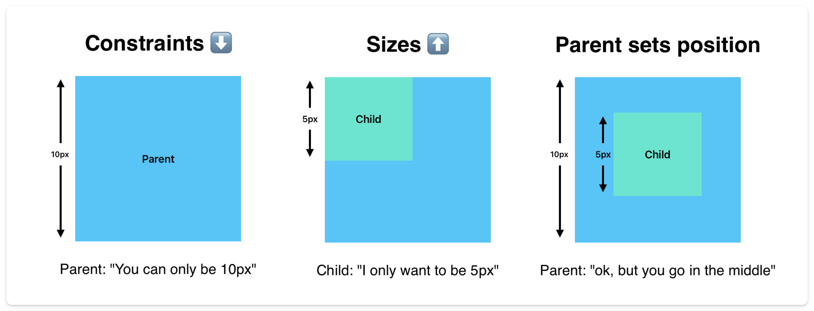

# Understanding Constraints

At some point, you will run into issues with UI. We need to understand how Flutter renders widgets to figure out what is happening. What process does Flutter go through to decide where and how the widget tree is structured?

## Box Constraint Model

The underlying mechanism for rendering your widgets onto the screen is called the Box Constraint Model.

The box constraint model has three simple rules:

1. Constraints go down.
2. Sizes go up.
3. Parent sets position.

The parent widget tells its child the maximum size it can be (constraints), the child tells the parent what size it will be within those constraints, and the parent says where it will be located.

The constraint for the widget at the top of the widget tree is the entire screen of the device, then the tree gets traversed downward, its location is set using the box constraint model, and then it gets painted onto the screen.

This is how your app turns into actual pixels.

> This model doesn't work when the parent doesn't know the constraints. This happens when you have an unknowable list of items that extend beyond the screen. This will be covered in the Slivers section in the Advanced UI.

## Quiz

**1. What are the three rules of the Box Constraint Model?**

- A) Constraints go down, sizes go up, parent sets position
- B) Sizes go down, constraints go up, child sets position
- C) Parent sets size, child sets position, constraints go down
- D) Child sets everything

Answer

- A) Constraints go down, sizes go up, parent sets position

**2. What is the initial constraint for the widget at the top of the widget tree?**

- A) Zero pixels
- B) The parent widget's size
- C) An infinite size
- D) The entire screen of the device

Answer

- D) The entire screen of the device

**3. When does the Box Constraint Model not work?**

- A) When using StatefulWidgets
- B) When the screen is too small
- C) When the parent doesn't know the constraints
- D) When using MaterialApp

Answer

- C) When the parent doesn't know the constraints

**4. In the Box Constraint Model, who determines the final position of a widget?**

- A) The child widget
- B) The Flutter framework
- C) The device screen
- D) The parent widget

Answer

- D) The parent widget

---

[← Course overview](../../../README.md)
