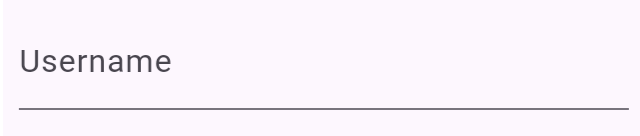

# TextField

I know I've already said this, but I'll say it again. There are a ton of widgets, and we can't cover all of them.

> We could if we really tried, but there's no point. Real mastery in programming isn't about memorizing every widget or function. It's about understanding core concepts, learning how components interact, and developing the skill to efficiently research and implement solutions as needed. The goal is to become adept at problem-solving, not to be a walking documentation.

But, I want to cover Forms since they are commonly used in most apps (and spoiler alert: it might be used in our project, in the next section).

## TextField

Before getting to forms, we need to discuss the `TextField` widget. This is the most basic input widget in Flutter. This widget allows the user to enter text and is highly customizable to look how you want.

```dart
TextField(
  decoration: const InputDecoration(labelText: 'Username'),
)
```



## TextEditingController

If you're coding along, you will notice that the `TextField` above doesn't do anything. That's because it doesn't have a `TextEditingController`. The `TextEditingController` class allows you to control a `TextField`. You can use it to get the current value of the `TextField` and set the `TextField` value.

```dart
final usernameController = TextEditingController();

TextField(
  controller: usernameController,
  decoration: const InputDecoration(labelText: 'Username'),
)

// To get the current value of the TextField
usernameController.text;

// To set the value of the TextField
usernameController.text = 'fornitelover5000';
```

## Assignment

Add an `ElevatedButton` between the `SizedBox` widgets and when you click it, it should update the `displayText` variable, and should update the `Text` widget to display "You typed: " followed by the text you entered.

## Challenge

Code: [starter code](code/initial) · [solution](code/solution)

Start in `lib/textfield.dart`. Tests: `test/textfield_test.dart`.

---

[← Course overview](../../../README.md)
