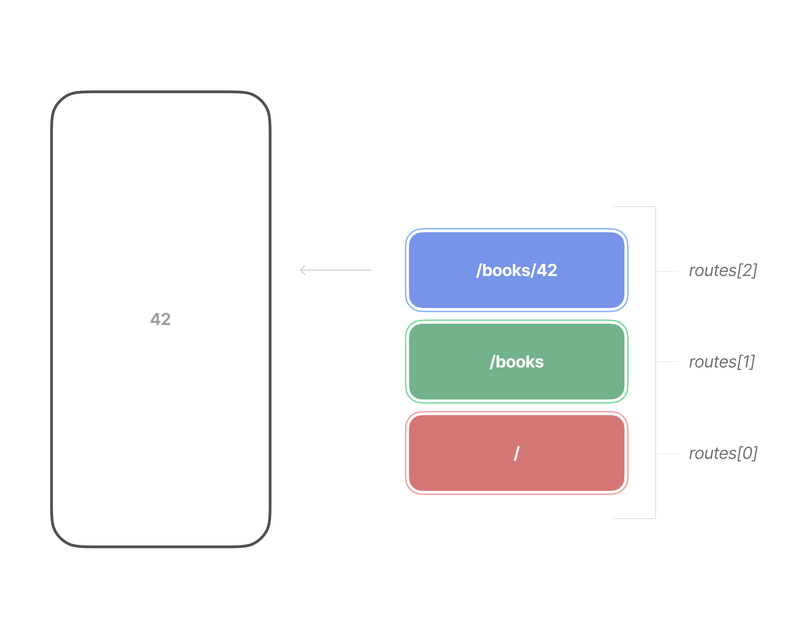

# Navigation Stack

Every app needs to navigate between pages, and Flutter does this using the `Navigator` widget. In most apps, this `Navigator` widget is hidden within the `MaterialApp`.

## How does navigation work?

The fundamental concept of navigation is the "stack". You can think of it like a stack of cards. The current page you are looking at is the card on the very top. There are two ways you can change which card you are looking at: by adding one on top ("pushing" it on top) or by removing the top card ("popping" it off the top).

### Understanding the Stack

Let's break this down with a real example:

1. You start on your home page (bottom of the stack)
2. You tap a books tab to view all the books (pushes books page on top)
3. You tap a specific book (pushes a page for the specific book on top)
4. When you press back, the specific book page is popped off
5. Press back again, the general books page is popped off
6. You're back at the home page.

## Quiz

**1. What is the main concept behind Flutter's navigation system?**

- A) A linked list of pages
- B) A stack of pages where you can push and pop
- C) A tree of pages
- D) A queue of pages

Answer

- B) A stack of pages where you can push and pop

**2. When you navigate to a new page in Flutter, what operation is performed?**

- A) The page is added to a queue
- B) The page is pushed onto the stack
- C) The page replaces the current page
- D) The page is inserted at the bottom

Answer

- B) The page is pushed onto the stack

**3. What happens when you press the back button in Flutter?**

- A) The current page is pushed
- B) The current page is popped from the stack
- C) The app closes immediately
- D) Nothing happens by default

Answer

- B) The current page is popped from the stack

**4. Which widget is responsible for managing navigation in Flutter?**

- A) Router
- B) Navigator
- C) PageView
- D) TabBar

Answer

- B) Navigator

---

[← Course overview](../../../README.md)
