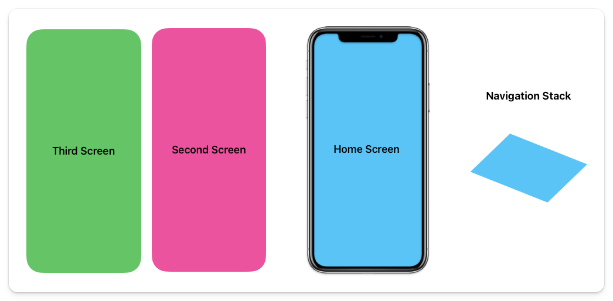
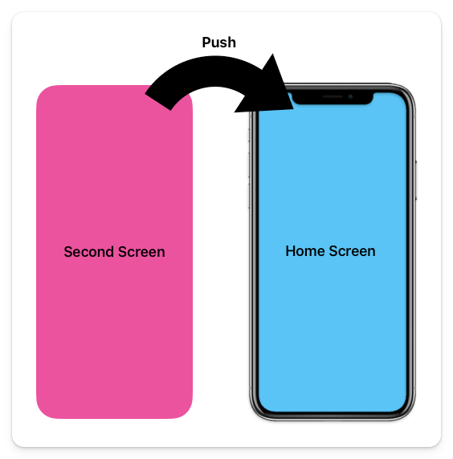
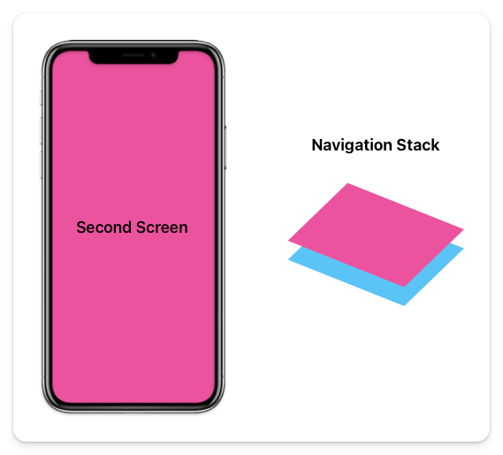
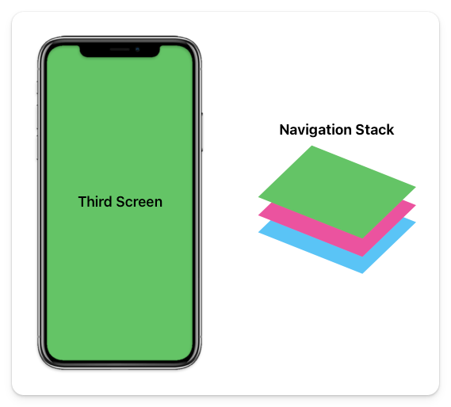

# Push

We will walk through a visual example that has three screens in total.

1. Home Page
2. Second Page
3. Third Page

In the diagram below, you can see the app's current state and what the stack looks like at that state.



### Push

Like in the card example, let's say we want our app to navigate to a different screen called "Second Screen". We want to push it onto the top of the stack of pages.



Once this is executed, the current application and stack will look like this.



If we follow the same process and navigate to a third screen, our application and stack will look like this.



That is the main concept of navigation within an application. To use it within your Flutter app, your code will look like this:

```dart
Navigator.of(context).push(
  MaterialPageRoute(builder: (context) => const SecondPage())
);
```

You will use the `Navigator` widget of the current [context](https://api.flutter.dev/flutter/widgets/BuildContext-class.html) and call the `push` method. This will add a new layer to the stack.

The navigation "stack" we were talking about is actually a stack of `Route` objects. These routes are the actual pathways to get to the specific screen. A `Route` can have some extra behaviors and properties. For example, you can define the type of animation used when bringing in the new page.

### MaterialPageRoute

In the code above, we use a `MaterialPageRoute`, a platform-specific `Route`. What does that mean?

It will check what platform you are running (e.g., iOS, Android) and perform the platform-specific animations for transitioning between pages.

For Android, it zooms and fades, while for iOS, it slides in from the right side.

## Assignment

Make sure that when you tap the button, it navigates to the second page.

## Challenge

Code: [starter code](code/initial) · [solution](code/solution)

Start in `lib/home_page.dart`.

---

[← Course overview](../../../README.md)
