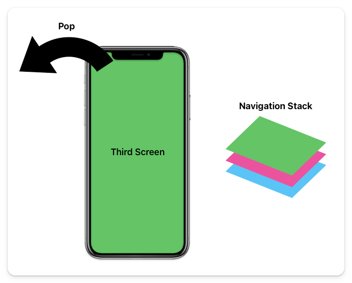
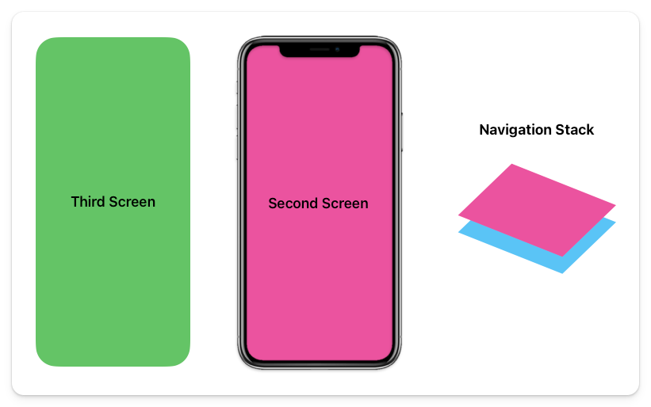

# Pop

To go back and see the previous "Second Screen" you need to "pop" the topmost layer of the current stack.



This will result in the stack being two pages deep, and you can see the "Second Screen" again.



To go back to the previous screen, the code will look like this:

```dart
Navigator.of(context).pop();
```

## Assignment

Navigate to the second page, and implement the functionality to go back to the previous page.

## Challenge

Code: [starter code](code/initial) · [solution](code/solution)

Start in `lib/home_page.dart`.

---

[← Course overview](../../../README.md)
