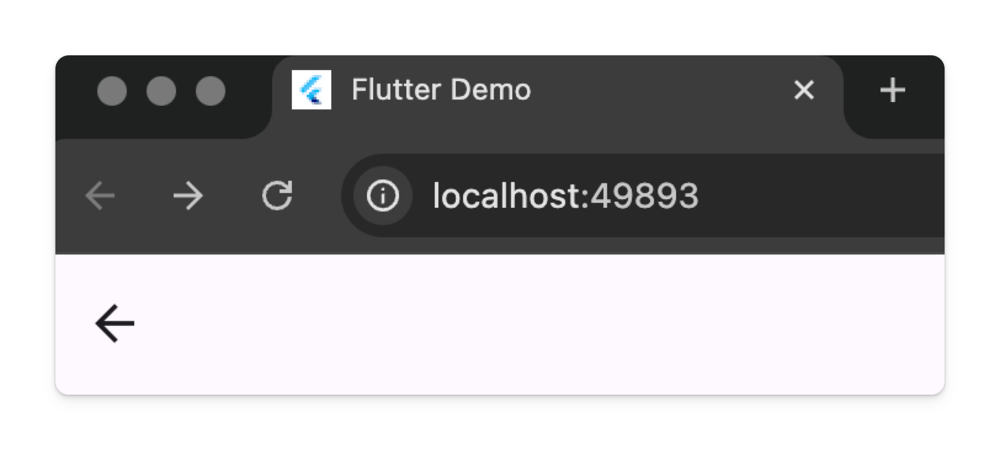
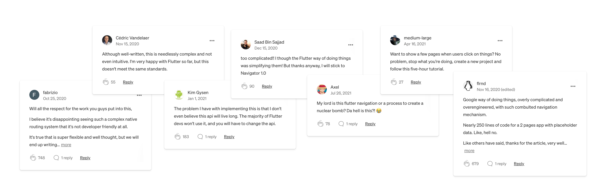

# Navigator 2.0

Navigation in Flutter is a tricky topic. The navigation we just discussed is the original navigation that came with the Flutter Framework when it was first released in 2018. Let's be very clear, if you have a simple app, you should use the navigation system that we just discussed. It is perfectly capable of handling most mobile applications.

The keyword there was "mobile". When you start working with Flutter Web, you will notice `Navigator` is lacking some features.

- URL is not synced
- The browser back button doesn't work properly

There are also a few more advanced features that are missing when you need a more complex navigation for mobile, like removing a route underneath the current route. It all centers around not having control of the entire navigation stack.

## Navigator 2.0

So around 2 years after Flutter's initial release, the team started focusing on making Flutter Web a valid option, and this came with a new navigation system in the 1.22 update.

At the time, it was called "Navigator 2.0", but now it is referred to by the actual implementation details: Pages API and Router API.

The original reception was not great.

Not going to lie, it was quite complicated, but they have simplified it a little over the years, and once you understand it, Pages and Router APIs are not thaaaat bad.

Having said that, the original navigation method is still fully supported, so if you don't need complex navigation features and are primarily focused on mobile, you don't need this. But as always, it's better to understand it. And by understanding it, you will understand how the original navigation system works as well.

## Quiz

**1. Why was the Navigator 2.0 reception not good?**

- A) It didn't solve any problems
- B) Due to complexity
- C) Haters being haters for no reason
- D) Navigator 1.0 was widely loved

Answer

- B) Due to complexity

---

[← Course overview](../../../README.md)
