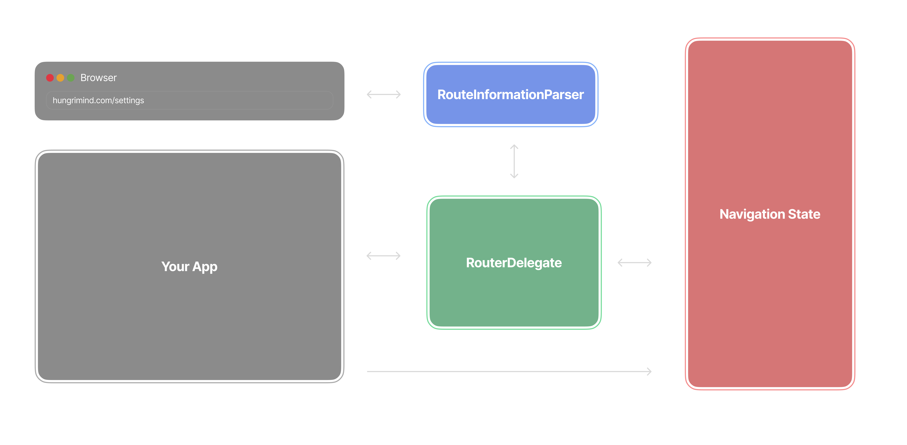

# RouteInformationParser

The code we built in the last lesson is missing a key part: the URL is not being updated. You probably didn't notice because you can't see the URL in our platform, but just trust me on this one.

> If you do see a URL in the platform, then we must have updated that and forgot to update this lesson, so please let me know in Discord :)

## RouteInformationParser

The `RouterInformationParser` is responsible for converting between the object you use in your navigation state and the URL. It has two functions that need to be overridden.



### parseRouteInformation

The `parseRouteInformation` function handles the path where a user types in a new URL or a deep link. The goal of this function is to convert the URL into the state that we use for navigation. In our case, the state is a String (hence the return type), and it needs to be one of the user-defined routes. You begin with a `RouteInformation` object, which is data from the system that includes the URL. Since our navigation state is the string of the URL we return that.

Once this is parsed, the `setNewRoutePath` that we defined in the `RouterDelegate` is called to replace the stack with this new state.

```dart
@override
Future<String> parseRouteInformation(
  RouteInformation routeInformation,
) async {
  return routeInformation.uri.toString();
}
```

### restoreRouteInformation

The `restoreRouteInformation` handles the other case, where some action was taken within the application that requires the URL to be updated. For this to work, we will need another override in the `RouterDelegate` called `currentConfiguration`. This gets triggered whenever the routing changes within the application.

```dart
@override
String? get currentConfiguration {
  return routes.value.last;
}
```

The configuration returns a string type since that’s the state type of our current route. This configuration is then used to update the URL.

```dart
@override
RouteInformation? restoreRouteInformation(String configuration) {
  if (configuration.isNotEmpty) {
    return RouteInformation(uri: Uri.parse(configuration));
  }
  return null;
}
```

Now we have a complete navigation system using Navigator 2.0, that is synchronized with the URL.

## Quiz

**1. What is the role of the parseRouteInformation?**

- A) Updates the widget tree based on user gestures
- B) Converts app navigation state back to a URL string
- C) Converts the URL to app navigation state
- D) Handles the visual transition animations between pages

<details>
<summary>Answer</summary>

- C) Converts the URL to app navigation state

</details>

**2. What is the role of the restoreRouteInformation?**

- A) Updates the widget tree based on user gestures
- B) Converts app navigation state back to a URL string
- C) Converts the URL to app navigation state
- D) Listens for back button presses and closes routes

<details>
<summary>Answer</summary>

- B) Converts app navigation state back to a URL string

</details>

---

[← Course overview](../../../README.md)
