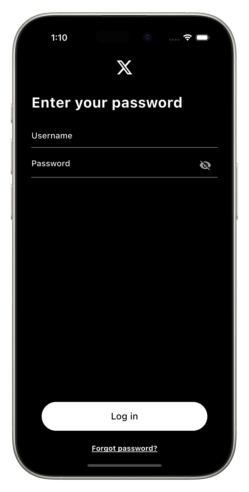
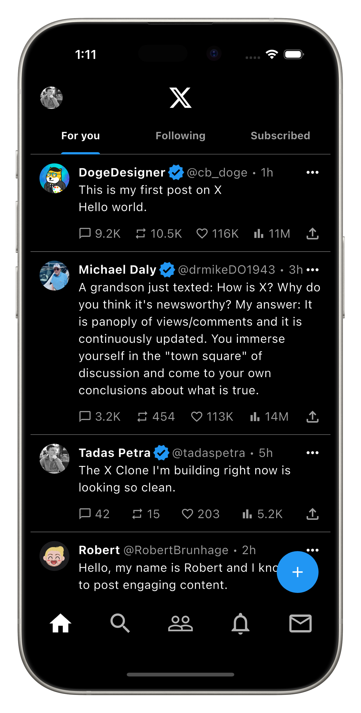

# X Clone

The first project we will build is a clone of X (formerly Twitter).

Up to this point we have learned the basics of building User Interfaces, and X is a perfect app to practice.

We will build the login screen and the home screen. It doesn't have to be interactive, but it does need to look like X.

Now, we don't expect you to remember every single parameter for every widget. Like we mentioned in a previous lesson, you don't need to remember every single one. But as you build more and more apps, you will start to remember more and more. In this section, if you don't remember what widget you need to use or what parameter you need, open the Flutter documentation in a new tab and utilize it.

## Quiz

**1. Let's start with the login screen. Are you ready?**

- A) Yes
- B) No

Answer

- A) Yes

---

[← Course overview](../../../README.md)
