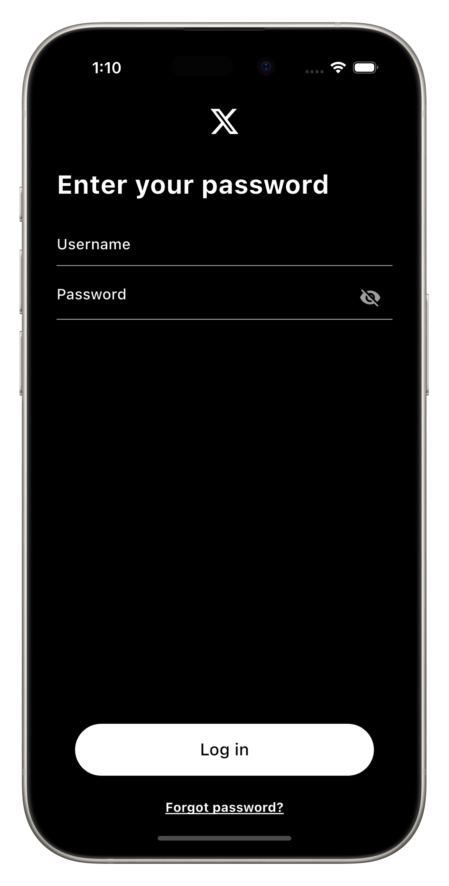
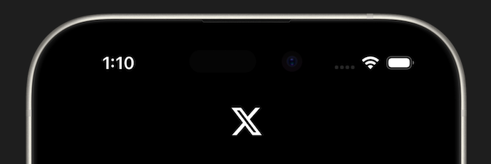

# App Bar

This first part of this project is to build the UI for the login screen to get you comfortable working with Flutter.

## Assignment

We need an `AppBar` at the top containing the X logo. Show the logo in the center of the app bar with a width of 30px.

The logo is white, make the app bar black so you can see it.

### Requirements

1. The logo is in the center of the app bar.
2. The logo is 30px wide.
3. The app bar is black.

> **Hint**
>
> The image file is already imported for you, and located in `assets/x-logo.png`.

## Challenge

Code: [starter code](code/initial) · [solution](code/solution)

Start in `lib/pages/signin.dart`. Tests: `test/pages/signin_test.dart`.

---

[← Course overview](../../../README.md)
