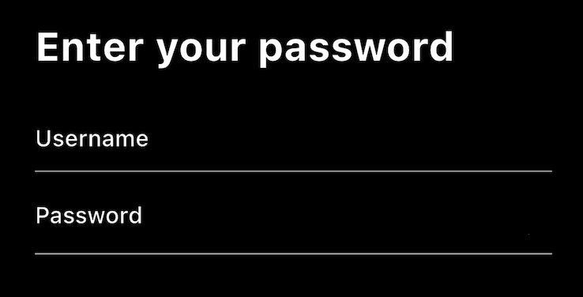

# Username and Password

Now we need a username and password field.

## Assignment

Add a `TextFormField` for the username and password. This should be within a `Form` widget and the end result should look like the image below.

### Requirements

- `Form` widget should contain a `Column` with a `crossAxisAlignment` of `CrossAxisAlignment.start` and two `TextFormField` widgets.
- The first `TextFormField` should have a `hintText` of “Username” and the second “Password”.
- Above the first `TextFormField` should be a title saying “Enter your password”, in bold with a font size of 28.
- The `Form` widget should be wrapped in a `Padding` of 20 all around.
- The `TextFormField` widgets should have an `enabledBorder` of `UnderlineInputBorder` of gray and a `focusedBorder` of the same but blue.
- The password field should be obscured.
- Add a `SizedBox` of height 20 between the title and the first `TextFormField`.
- Add a `SizedBox` of height 10 between the first `TextFormField` and the second.

## Challenge

Code: [starter code](code/initial) · [solution](code/solution)

Start in `lib/pages/signin.dart`. Tests: `test/pages/signin_test.dart`, `test/main_test.dart`.

---

[← Course overview](../../../README.md)
