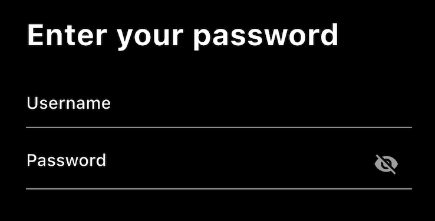

# Password Visibility

Sometimes when your are typing your password, you want to make sure that you got it right. To do this, you can add a button to show and hide the password.

## Assignment

Create a variable to hold the password visibility state. Then add a button to the `suffixIcon` field of the `TextFormField` widget. This button should toggle the visibility of the password and display an `Icons.visibility` or `Icons.visibility_off` icon based on the state.

Your end result should look like this:

### Requirements

1. Password should be hidden by default.
2. Button should toggle the visibility of the password.
3. When visibility is toggled, the button should show the correct icon.

## Challenge

Code: [starter code](code/initial) · [solution](code/solution)

Start in `lib/pages/signin.dart`. Tests: `test/pages/signin_test.dart`, `test/main_test.dart`.

---

[← Course overview](../../../README.md)
