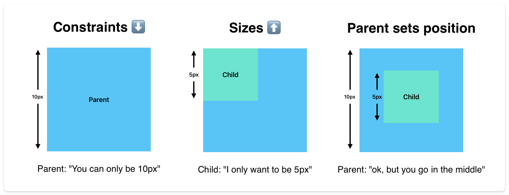
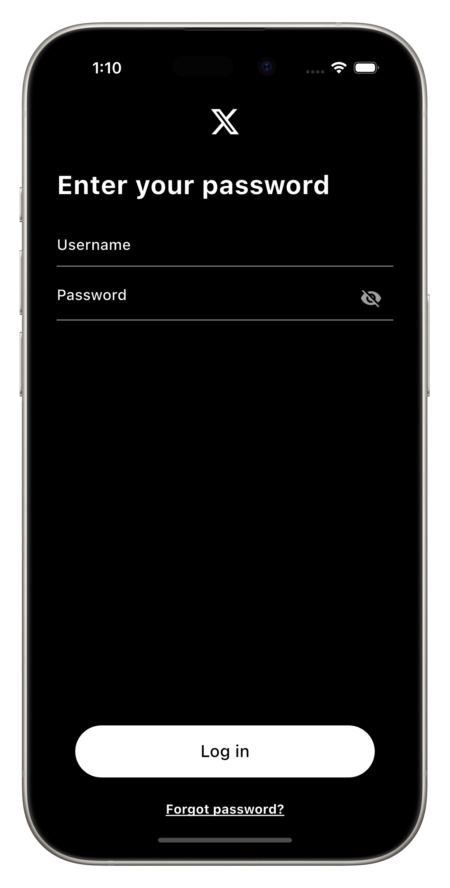

# Add Buttons

Now we need to add buttons. They should be centered at the bottom of the screen. There is one tricky part we will do here, and that's making the button take up the full width of the screen. This has to do with the layout constraints again.

A button will by default be the width of the parent. Since we want some padding the parent will be a `Padding` widget, which doesn't have a width. Because of that the button will by default take the width of the text within it.

How can we fix this? Well we can definitely set the width of the parent to be the full width of the screen because "Parent sets constraints". But we can also set the minimum width of the button to be infinity because "Child sets it's own size". By setting the minimum width to be infinity, the button will take the full width of the screen. Neither of these options are wrong or right, they are just different ways to achieve the same result.

## Assignment

Add a `ElevatedButton` and a `TextButton` at the bottom of the page.

Your end result should look like this:

### Requirements

1. `ElevatedButton` in the bottom center of the screen with "Log in" as the label.
2. Width of the button should be the full width of the screen and a height of 50.
3. And should have 10 vertical and 20 horizontal padding.
4. Should have a shape of `RoundedRectangleBorder` with a radius of 30.
5. `TextButton` below the `ElevatedButton` saying "Forgot Password?".
6. `TextButton` should be underlined and centered.

> **Hint**
>
> Use a `Spacer` widget to push the button to the bottom of the screen.

## Challenge

Code: [starter code](code/initial) · [solution](code/solution)

Start in `lib/pages/signin.dart`. Tests: `test/pages/signin_test.dart`, `test/main_test.dart`.

---

[← Course overview](../../../README.md)
