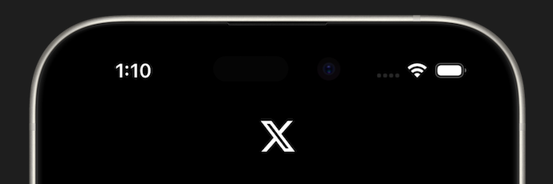

# App Bar

The home page needs an app bar as well. There are a few ways to get a circular profile picture in Flutter like `ClipOval` or just a container with a circular shape. But for something like this, there is a simple to use widget called `CircleAvatar` that will make the image circular.

## Assignment

Add an app bar to the home page.

### Requirements

1. X logo in the middle with a width of 30 (like in the sign in page).
2. A profile picture should be on the left using a `NetworkImage` widget.
3. The `NetworkImage` should be used as the `backgroundImage` parameter of a `CircleAvatar` widget with a radius of 15.
4. The `CircleAvatar` should be wrapped with a `Center` widget. This is due to the contraints we learned in the the [Understanding Constraints lesson](/learn/flutter/002-user-interface-model/003-layouts/005-constraints).

> **Hint**
>
> The `NetworkImage` widget allows you to load any image from the internet. You can use the `https://picsum.photos/300/300` URL for the profile picture or the image URL from your X profile picture.

## Challenge

Code: [starter code](code/initial) · [solution](code/solution)

Start in `lib/pages/home.dart`. Tests: `test/pages/signin_test.dart`, `test/pages/home_test.dart`, `test/main_test.dart`.

---

[← Course overview](../../../README.md)
