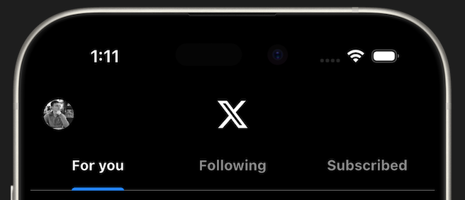

# Tab Bar

Now we need to add a tab bar that switches between the For You, Following, and Subscribed tabs.

To make this happen you need a pair of widgets: `TabBar` and `TabBarView`. The `TabBar` widget is the one that shows the tabs and the `TabBarView` widget is the one that shows the content for each tab.

Now these need to be synced up to work together. Similar to how you can use a `TextEditingController` to get the status of a text field, you can use a `TabController` to get the status of the tab bar.

To do this, you would need to change this page to a StatefulWidget and create a `TabController` in the `initState` method and pass it to the `TabBar` and `TabBarView` widgets.

But there is a simpler way to do this. You wrap the entire page in a `DefaultTabController` widget. This widget will automatically create a `TabController` for you behind the scenes and sync up the `TabBar` and `TabBarView` widgets.

## Assignment

Add only the `TabBar` and the `DefaultTabController` to the home page. (We will add the `TabBarView` in the next lesson.)

### Requirements

1. Should have 3 tabs: For You, Following, and Subscribed.
2. The For You tab should be selected by default.
3. The active tab should be highlighted with a blue underline.
4. The inactive tabs should be grey.
5. The font in the `TabBar` should be bold.
6. The divider between the tabs and the content should be height 0.5 and color grey.

## Challenge

Code: [starter code](code/initial) · [solution](code/solution)

Start in `lib/pages/home.dart`. Tests: `test/pages/signin_test.dart`, `test/pages/home_test.dart`, `test/main_test.dart`.

---

[← Course overview](../../../README.md)
