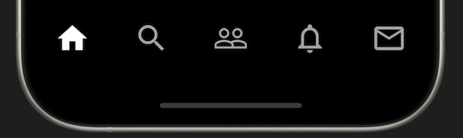

# Bottom Nav Bar

Now we need a bottom navigation bar. The `Scaffold` widget already has a `bottomNavigationBar` property. This is where we will add the `BottomNavigationBar` widget with the property `items` containing 5 `BottomNavigationBarItem` widgets.

## Assignment

Add a `BottomNavigationBar` to the `Scaffold` widget.

### Requirements

1. Add a `BottomNavigationBar` to the `Scaffold` widget.
2. Add a `BottomNavigationBarItem` for each item using the following icons with size 36:
   - Icon.home
   - Icon.search
   - Icon.people_outline
   - Icon.notifications_none_outlined
   - Icon.mail_outline
3. The selected icon should be white.
4. Each `BottomNavigationBarItem` should have no label.
5. It should have a type of `BottomNavigationBarType.fixed`.

## Challenge

Code: [starter code](code/initial) · [solution](code/solution)

Start in `lib/pages/home.dart`. Tests: `test/pages/signin_test.dart`, `test/pages/home_test.dart`, `test/main_test.dart`.

---

[← Course overview](../../../README.md)
