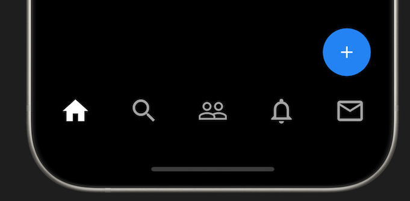

# Floating Action Button

Lastly we need a floating action button. It's very similar to `BottomNavigationBar`. You add it using a property called `floatingActionButton` on the `Scaffold` widget.

## Assignment

Add a `FloatingActionButton` to the `Scaffold` widget.

### Requirements

1. It should be circular.
2. It should have an icon of `Icon.add`.
3. It should have a background color of `Colors.blue`.

## Challenge

Code: [starter code](code/initial) · [solution](code/solution)

Start in `lib/pages/home.dart`. Tests: `test/pages/signin_test.dart`, `test/pages/home_test.dart`, `test/main_test.dart`.

---

[← Course overview](../../../README.md)
