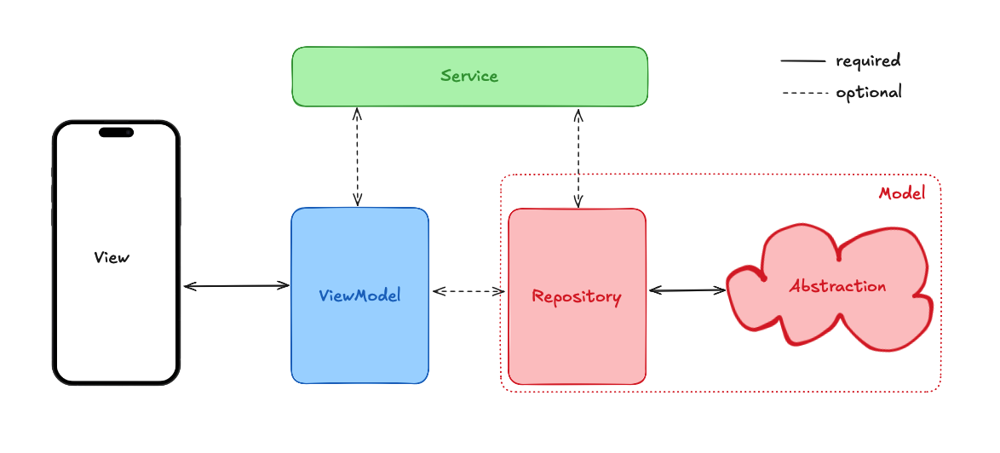

# MVVM Introduction

Architecture is a funny topic. It is also a topic people feel very strongly about. We feel strongly about it, too. Some people feel strongly about "their architecture" when they have watched 2 YouTube videos, and the only app they made is the counter app that counts backward. Our strong feelings come from almost a decade of software engineering experience and leading app development for apps used by millions of people.


All jokes aside, one thing I want you to take away from this section is that architecture is just one part of app development. If something feels off, or you need to fix a specific issue, you can always refactor and "break the rules" (as long as you know why and how you break the rules).

Let's get into MVVM, the architecture we use for production projects.

## Terminology

MVVM stands for Model-View-ViewModel.

- **Model**: The data layer of the application.
- **View**: A stateless or stateful widget that renders the UI.
- **View Model**: A class responsible for handling a specific view's business logic and state.

MVVM is the core concept, but we need some more concepts to have a scalable and structured app state.

- **Service**: A class responsible for raising the business logic and state up a level that lets the view models share the same logic and state.
- **Repository**: A class responsible for retrieving data outside our app. Part of the "model" layer.
- **Abstraction**: A class that is a wrapper around an external resources. Part of the "model" layer.



This architecture allows you to move business logic from the view and into view models and services. This will enable you to simplify and reuse views more easily but make your logic fully unit-testable.

There are some rules that we must enforce when using this architecture.

## MVVM rules

1. Views should never use services directly, just view models.
2. In theory, the view should contain no logic (this is not always possible) but defer logic to the view model as much as possible (that is its role)
3. View models should never use other view models. Move that shared functionality into a service and consume it from there.
4. View models should not have access to `BuildContext`. Defer to the view.
5. Dependencies should always be injected through the constructor.

### Navigation

Because one of the rules is no `BuildContext` within the view model, navigation responsibilities should be handled by the view. One effective method is to have the view model return values, which the view can check before navigating. Sealed classes can simplify pattern matching on the result for more complex navigation scenarios.

```dart
sealed class AuthenticationState {}

class SuccessAuthenticationState extends AuthenticationState {}

class FailedAuthenticationState extends AuthenticationState {
  // You can have properties here if you want
}

class MyViewModel {
  MyViewModel({required Auth auth}) : _auth = auth;

  final Auth _auth;

  AuthenticationState doSomething() {
    final response = someAuthRequest();
    if(response.success == true) {
      return SuccessAuthenticationState();
    }

    return FailedAuthenticationState();
  }
}

// method from a view
void navigateSomewhere() {
  final state = viewModel.doSomething();
  switch(state) {
    case SuccessAuthenticationState():
      // navigate to X
    break;
    case FailedAuthenticationState():
      // navigate to Y
    break;
  }
}
```

### Why all these rules?

This architecture makes testing way simpler. This is as expected. The better your code follows good coding principles, the easier it should be to test. The view model and services are fully testable with unit tests.

> Tip: Aim to minimize the use of mocks, favor fakes where possible, and focus on testing the crucial logic.

We don't need to understand everything happening here (there is a testing section later in the course), but we wanted to showcase how simple this architecture makes our tests. Taking the navigation example, here are two tests:

```dart
void main() {
  group('MyViewModel', () {
    late MyViewModel viewModel;
    late MockAuth mockAuth;

    setUp(() {
      mockAuth = MockAuth();
      viewModel = MyViewModel(auth: mockAuth);
    });

    test('doSomething returns SuccessAuthenticationState when response is successful', () {
      // Mocking the response for success
      when(mockAuth.someAuthRequest()).thenReturn(Response(success: true));

      // Act
      final result = viewModel.doSomething();

      // Assert
      expect(result, isA<SuccessAuthenticationState>());
    });

    test('doSomething returns FailedAuthenticationState when response is not successful', () {
      // Mocking the response for failure
      when(mockAuth.someAuthRequest()).thenReturn(Response(success: false));

      // Act
      final result = viewModel.doSomething();

      // Assert
      expect(result, isA<FailedAuthenticationState>());
    });
  });
}
```

## Quiz

**1. What does MVVM stand for in Flutter architecture?**

- A) Model-View-Virtual Machine
- B) Model-View-ViewModel
- C) Mobile-View-ViewModel
- D) Model-Virtual-View Manager

<details>
<summary>Answer</summary>

- B) Model-View-ViewModel

</details>

**2. Which component in MVVM is responsible for handling business logic and state?**

- A) Model
- B) View
- C) ViewModel
- D) Service

<details>
<summary>Answer</summary>

- C) ViewModel

</details>

**3. What is the primary purpose of a Service in MVVM?**

- A) To render the UI
- B) To define data structures
- C) To raise business logic and state up a level for sharing between view models
- D) To handle user input directly

<details>
<summary>Answer</summary>

- C) To raise business logic and state up a level for sharing between view models

</details>

**4. How should navigation be handled in MVVM according to the lesson?**

- A) Directly in the ViewModel using BuildContext
- B) By the View, based on values returned from the ViewModel
- C) Only through the Model layer

<details>
<summary>Answer</summary>

- B) By the View, based on values returned from the ViewModel

</details>

---

[← Course overview](../../../README.md)
