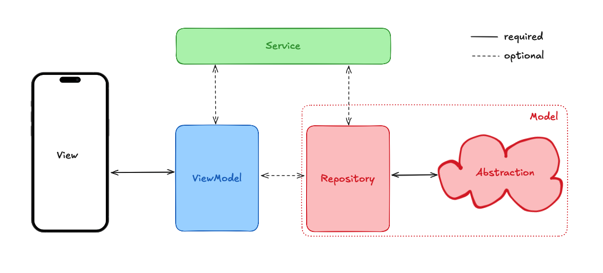

# Repositories

Until now we have only covered the VVM part of MVVM. The model part is the data layer.

The part of the model layer that interacts with our application is called repositories. Repositories are an abstraction layer between the app, and the external resources. This can include databases, HTTP requests, file systems, caches, packages and external resources.

The key idea is that repositories provide a consistent interface for the application to interact with various data sources, regardless of their nature. This abstraction allows the application to:

1. Fetch data from multiple sources and use the best data
2. Switch between different data sources without changing the application logic
3. Combine data from various sources into a single, coherent interface

For example, a repository might fetch user data from a local database, retrieve their recent activity from a REST API, and check their subscription status from a third-party service - all while presenting a unified interface to the rest of the application.

## Testing

Having this as a separate layer helps keep the data in your app organized and makes testing your application significantly easier.

With the repository layer, testing your application becomes significantly easier. Instead of having to mock out every outside service, you just mock your repository. This simplifies the testing process and makes it more convenient for developers.

## Quiz

**1. What is the main purpose of repositories in MVVM?**

- A) To provide a consistent interface between the app and external resources
- B) To handle UI logic
- C) To manage application state
- D) To create database tables

Answer

- A) To provide a consistent interface between the app and external resources

**2. Which of these is NOT mentioned as a benefit of using repositories?**

- A) Improved app performance
- B) Ability to fetch data from multiple sources
- C) Easier testing through mocking
- D) Switching between different data sources without changing app logic

Answer

- A) Improved app performance

---

[← Course overview](../../../README.md)
