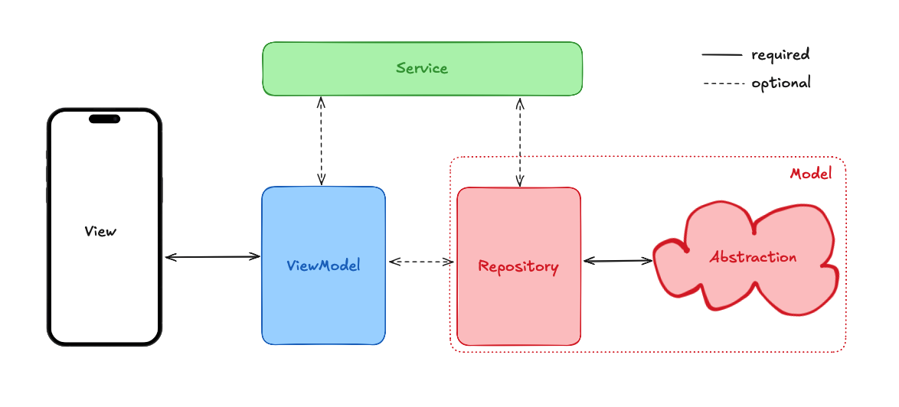

# Abstracting Dependencies

There is one last abstraction layer that we add to make dealing with external resources and abstracted away from our beautiful app code. We call this the **Abstraction** Layer. This is a fancy class for wrapping external dependencies.



For example, suppose you use a package to check your phone's battery. In that case, this allows you to control that dependency's interface more easily and allows for easier testing.

```dart
class BatteryAbstraction {
  /// wrap the interface of the native battery package or native calls
}
```

There is nothing specific here to show, but once you have created your abstraction your constructor injects this wherever it is needed.

```dart
class HomeViewModel {
  HomeViewModel({required BatteryAbstraction batteryAbstraction}) : _batteryAbstraction = batteryAbstraction;

  final BatteryAbstraction _batteryAbstraction;

  // now you can use the abstraction as you wish are during tests it's very straightforward to fake or mock out the abstraction class.
}
```

## Why all this abstraction?

The previous few lessons have only been talking about abstraction after abstraction after abstraction. What the heck? Once again, you don't have to use all of this for a simple todo app. The level of abstraction that we covered here is similar to what big companies use, where they **need** things abstracted this way for teams to work efficiently together, code to be maintainable for the foreseeable future, and testing.

With all this abstraction, unit testing has become greatly simplified. If you use a camera package and only need to take a picture, with a 'CameraAbstraction`, you can only expose the picture-taking feature. Then, during testing, you only need to mock this one feature instead of the entire camera package functionality.

In the future, if you need more functionality, add it to the abstraction, update your tests, and your code is simple and easy to review for the team.

Again, use what you need for the projects you are working on. The important thing is to be aware of this stuff so that when you need it, you know where to go.

## Quiz

**1. What is the main purpose of the Abstraction Layer?**

- A) To manage application state
- B) To handle UI rendering
- C) To store data locally
- D) To wrap external dependencies and control their interface

<details>
<summary>Answer</summary>

- D) To wrap external dependencies and control their interface

</details>

**2. Why is abstracting dependencies beneficial for testing?**

- A) It makes tests run faster
- B) It reduces the number of tests needed
- C) It makes it easier to fake or mock out dependencies
- D) It automatically generates tests

<details>
<summary>Answer</summary>

- C) It makes it easier to fake or mock out dependencies

</details>

---

[← Course overview](../../../README.md)
