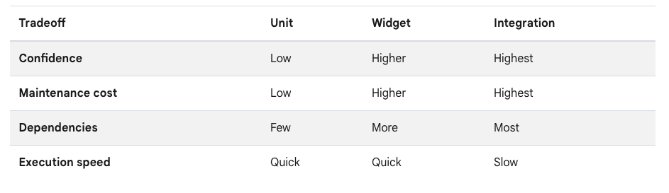

# What is a Test?

A test is code written outside your application that checks whether your app functions correctly. While you can definitely test your applications manually, using the provided testing features gives the following benefits.

1. Repeatable, Automated, Faster
2. Scalable
3. Reliable
4. Isolated
5. Gives you confidence

## How to create a test

You will need to install a testing package to test apps in Flutter. You can choose either, but the `flutter_test` comes preinstalled into the starter project.

- `test` - This is a general testing package that can be used for any dart project (not only Flutter).
- `flutter_test` - A flutter-specific testing framework with utilities to simplify Flutter testing.

Both of these packages run a script that executes your tests. The script looks for files that end with `_test.dart` in the `test` folder at the root of your Flutter project.

In the starter project, you should see a `widget_test.dart` file with a simple example of testing the counter button.

Each test file should have a `main` function: the test's entry point. You will write your tests, test groups, and supporting functions within this main function.

## Types of Tests

Flutter supports three types of testing: **Unit, Widget and Integration.**

Each of these tests can cover different parts of the application, but they also have their tradeoffs.



We will cover each of these tests in-depth, but I want to give a quick preview before diving in.

### Unit Testing

Unit testing is the smallest and fastest testing option. The goal is to test a single “unit” of code. This means a single logical function. Unit tests are best for testing “business logic”. When using MVVM, your unit tests will test the ViewModel and the Services.

Here is a really simple `Demo` class with an add function and the test for that function.

```dart title="lib/demo.dart"
class Demo {
  int add(int a, int b) {
    return a + b;
  }
}
```

```dart title="test/demo_test.dart"
void main() {
  test('When adding two numbers, it should return the sum of two numbers', () {
    final demo = Demo();

    final result = demo.add(1, 2);

    expect(result, 3);
  });
}
```

### Widget Testing

Unit tests are for “business logic”, while widget tests are for testing the user interface.

Widget tests are executed in a simulated environment. It creates a minimal simulation behind the scenes of your application and then walks through it based on the instructions in the test.

This is the example code that comes with the starter project. It checks that the counter starts at 0 and increments and ensures it’s at 1.

```dart title="test/widget_test.dart"
void main() {
  testWidgets('Counter increments smoke test', (WidgetTester tester) async {
    // Build our app and trigger a frame.
    await tester.pumpWidget(const MyApp());

    // Verify that our counter starts at 0.
    expect(find.text('0'), findsOneWidget);
    expect(find.text('1'), findsNothing);

    // Tap the '+' icon and trigger a frame.
    await tester.tap(find.byIcon(Icons.add));
    await tester.pump();

    // Verify that our counter has incremented.
    expect(find.text('0'), findsNothing);
    expect(find.text('1'), findsOneWidget);
  });
}
```

### Integration Testing

Integration tests are a bit more cumbersome. Widget tests run in a simulated environment, while integration tests are more hardcore. These tests run either on the physical device or an emulator.

To do this, you must add a package called `integration_test`, included in the Flutter SDK but not in the `pubspec.yaml` by default.

```yaml title="pubspec.yaml"
dev_dependencies:
flutter_test:
  sdk: flutter
flutter_lints: ^4.0.0
integration_test:
  sdk: flutter
```

The integration tests must also live in a separate `integration_test` folder. Whenever you run an integration, you will see the application pop up on an emulator or a physical device (depending on where you choose to run it).

Integration tests are special because they have the full application loaded with all its dependencies. It’s an automated test using the actual application, not just a simulated version.

They are also referred to as “end-to-end” tests because they test everything “end-to-end”.

We will cover all these testing approaches in depth in the next few lessons.

## Manual Testing

This doesn’t mean that you shouldn’t do any manual testing. Even if you have tested every single line of code in your app (which we don’t recommend doing), you would still want to test manually.

Manual testing can find issues with the “feel” of your application. While the code might technically work well, and the widget tests all pass, you will only find user experience or visual design issues through manual testing.

Also, using manual testing, you might discover some edge cases that weren’t covered by your tests. If your goal is to test everything, you should add these edge cases to your tests once you find them.

## Quiz

**1. What is a test?**

- A) Code written outside your application that verifies your app's functionality
- B) A manual process of clicking through your app to find bugs
- C) Code written inside your application to catch runtime errors
- D) A debugging tool that shows print statements

<details>
<summary>Answer</summary>

- A) Code written outside your application that verifies your app's functionality

</details>

**2. Which testing package comes pre-installed in a new Flutter project?**

- A) flutter_test
- B) test
- C) integration_test
- D) unit_test

<details>
<summary>Answer</summary>

- A) flutter_test

</details>

**3. What is the correct file naming convention for test files in Flutter?**

- A) Files must end with _test.dart
- B) Files must start with test_
- C) Files must be named test.dart
- D) Files can have any name in the test folder

<details>
<summary>Answer</summary>

- A) Files must end with _test.dart

</details>

---

[← Course overview](../../../README.md)
