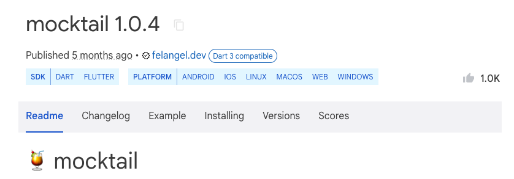

# Mocks

Testing has seemed pretty easy until now. While the testing basics are quite simple, they can get complicated quickly.

Most functions or features within an application don’t execute all the logic within that same function. Instead, they call out to other functions, services, and repositories to accomplish whatever the goal is.

For example let’s widget test a login form.

1. We want to check that the user can enter text into all the forms
2. That our validator doesn’t allow usernames less than six characters
3. That our email text field is a valid email
4. If all the information is valid, we navigate to the home screen.

Do you see a problem we might encounter trying to test this?

Remember, Widget Tests do not run on any device or emulator. This means we might not have access to any outside services that our app needs to use.

The first three tests should be easy, but navigating to the next screen requires a valid response from our authentication service (ex., Firebase Auth). Our tests will fail since the widget test cannot access outside services.

So what do we do? Do we forget about testing the login form and move on? Maybe, but you should never give up because of a technical limit. Giving up is only acceptable when you understand how it works and why and don’t want to do it.

The solution is **Mocks or Fakes**

Mocking and Faking means to create an alternate implementation of an existing class. This alternate implementation allows you to have behaviors different from the production code. In the example we walked through, we are trying to test our app's navigation to the home screen. So, we always want our database to return an authenticated user. To do this, we would mock the function calling the database and stub it with what we want it to return for our test.

The next section will cover stubbing. Mocking technically creates the alternate class, and stubbing defines the return from the functions within the alternate class. Often, people refer to both of these functions as mocking.

These alternate implementations can be written by hand, which would be quite tedious. Thankfully, some packages do this for you. We use the `mocktail` package for its simplicity.



To mock a class with `mocktail` you extend `Mock` and implement the class you are mocking. These mocks might be reused across different tests, so making them private is a good practice.

```dart
class _MockDemo extends Mock implements Demo {}
```

When you use them, you must create stubs using those mocks.

## Quiz

**1. What is the main purpose of mocking in widget tests?**

- A) To make tests run faster
- B) To test UI layouts
- C) To simulate external dependencies that aren't available during testing
- D) To debug widget tests

<details>
<summary>Answer</summary>

- C) To simulate external dependencies that aren't available during testing

</details>

**2. What's the difference between mocking and stubbing?**

- A) They are exactly the same thing
- B) Stubbing creates the class, while mocking defines the return values
- C) Mocking is for classes, stubbing is for functions
- D) Mocking creates the alternate class, while stubbing defines the return values

<details>
<summary>Answer</summary>

- D) Mocking creates the alternate class, while stubbing defines the return values

</details>

**3. How do you create a mock class using mocktail?**

- A) Extend Mock and implement the class you want to mock
- B) Create a new instance of the original class
- C) Copy and paste the original class
- D) Use the @mock annotation

<details>
<summary>Answer</summary>

- A) Extend Mock and implement the class you want to mock

</details>

**4. Why might you need mocks in a login form widget test?**

- A) To test the UI layout
- B) To validate form inputs
- C) To simulate authentication service responses without real network calls
- D) To test button clicks

<details>
<summary>Answer</summary>

- C) To simulate authentication service responses without real network calls

</details>

---

[← Course overview](../../../README.md)
