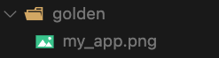
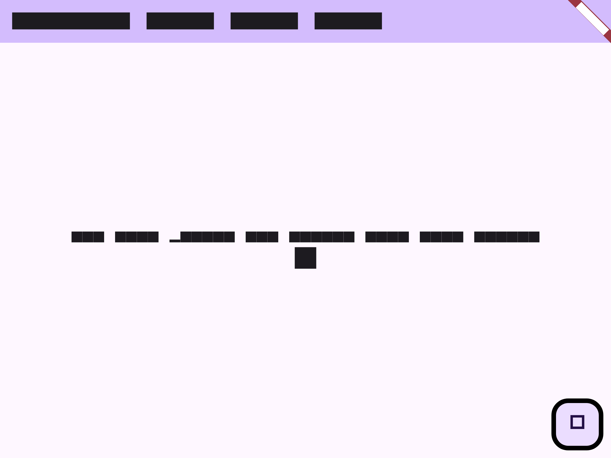
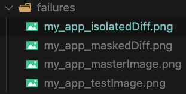
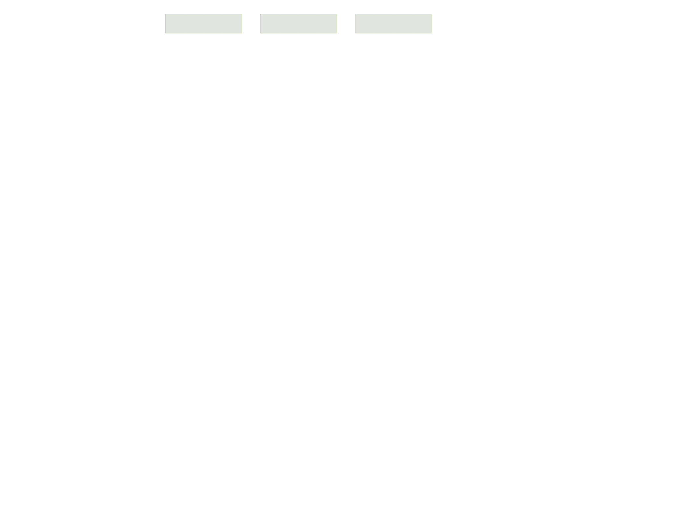
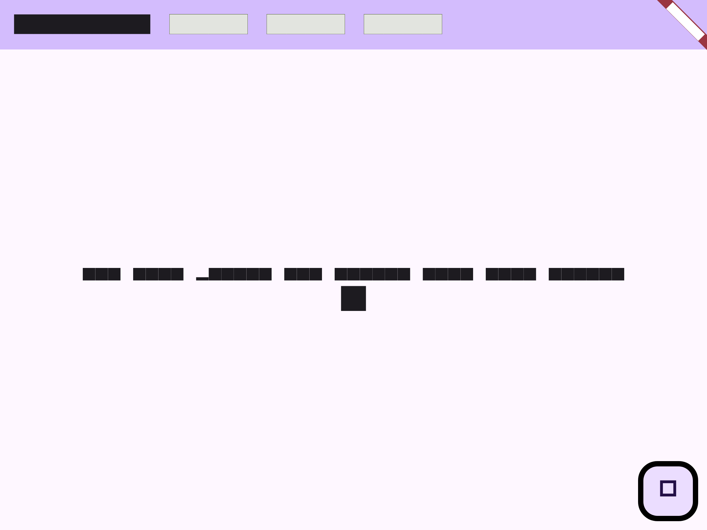

# Golden Testing

Golden files testing is the least talked about test that Flutter provides, but they are some of the most powerful.

To run a golden test, you must have a “golden image” or “golden file”. This is an actual PNG of what the UI should look like. When you run a golden test, it checks whether the current UI in the test matches that image pixel-for-pixel. So, if any changes to the UI have been introduced, your test will fail.

The key part of this whole test is creating that “golden image”. To create a golden image, you only need to write a test with a matcher of `matchesGoldenFile`.

We can use the default widget test that comes with the Flutter starter project and add an expectation of how the whole app should look.

```dart title="test/widget_test.dart"
testWidgets('Counter increments smoke test', (WidgetTester tester) async {
  // Build our app and trigger a frame.
  await tester.pumpWidget(const MyApp());

  // Verify that our counter starts at 0.
  expect(find.text('0'), findsOneWidget);
  expect(find.text('1'), findsNothing);

  // Tap the '+' icon and trigger a frame.
  await tester.tap(find.byIcon(Icons.add));
  await tester.pump();

  // Verify that our counter has incremented.
  expect(find.text('0'), findsNothing);
  expect(find.text('1'), findsOneWidget);

  await expectLater(find.byType(MyApp), matchesGoldenFile('golden/my_app.png'));
});
```

Within the `matchesGoldenFile`, you must put the pathname where you want the image generated.

To generate this image, you need to run the following test command: `flutter test --update-goldens`. After you run this, you should see a folder with your app's image. The text characters should show up as black squares. This is used to have consistent testing. But you can change it by updating the font in your testing configuration.





Once this golden file is generated, if you update the title and run the `flutter test` without the `--update-goldens` flag, you will see the test will fail.

It also creates a `failures` folder to see what was wrong.



It shows the expected and actual images and the differences between the two. Since we updated the title, we should see the difference in the titles shown by the grey squares.

 

## Quiz

**1. What is the main purpose of golden tests?**

- A) To test widget interactions
- B) To compare UI against a reference image pixel-by-pixel
- C) To test business logic
- D) To measure test performance

<details>
<summary>Answer</summary>

- B) To compare UI against a reference image pixel-by-pixel

</details>

**2. Which command is used to generate golden files?**

- A) flutter test
- B) flutter golden
- C) flutter test --update-goldens
- D) flutter create-golden

<details>
<summary>Answer</summary>

- C) flutter test --update-goldens

</details>

**3. What happens when a golden test fails?**

- A) The app crashes
- B) Nothing, it just shows an error message
- C) A failures folder is created showing the differences
- D) The test is automatically updated

<details>
<summary>Answer</summary>

- C) A failures folder is created showing the differences

</details>

---

[← Course overview](../../../README.md)
