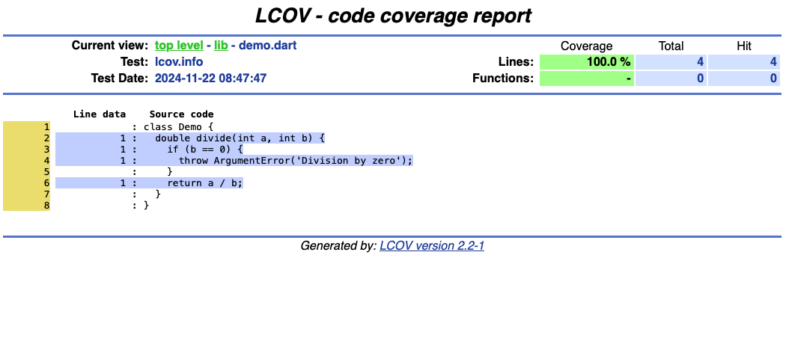

# Code Coverage

To generate a coverage report for your Flutter project, run:

```bash
flutter test --coverage
```

This command will:

1. Execute all your tests
2. Create a `coverage` directory in your project root
3. Generate an `lcov.info` file containing the raw coverage data

## Viewing Coverage Reports

The raw `lcov.info` file isn't human-readable, but you have several options to visualize it:

## Option 1: VSCode Extension

1. Install the "Coverage Gutters" extension for VSCode
2. Open your project files to see coverage indicators in the editor

## Option 2: HTML Report

1. Install the LCOV package:

   ```bash
   # On macOS
   brew install lcov

   # On Ubuntu
   sudo apt-get install lcov
   ```

2. Generate an HTML report:

   ```bash
   genhtml coverage/lcov.info -o coverage
   ```

3. Open `coverage/index.html` in your browser

## Understanding the Report

The HTML report provides:

- Overall coverage percentage
- File-by-file breakdown
- Line-by-line analysis showing:
  - Green: Covered lines
  - Red: Uncovered lines
  - Numbers: How many times each line was executed



## Quiz

**1. What is code coverage primarily used for?**

- A) To make code run faster
- B) To measure how much of your code is being tested
- C) To find runtime errors
- D) To optimize build times

<details>
<summary>Answer</summary>

- B) To measure how much of your code is being tested

</details>

**2. Which command generates coverage reports in Flutter?**

- A) flutter coverage
- B) flutter test --coverage
- C) flutter analyze
- D) flutter test --report

<details>
<summary>Answer</summary>

- B) flutter test --coverage

</details>

**3. What file is generated when running coverage tests?**

- A) coverage.json
- B) test-report.xml
- C) lcov.info
- D) coverage.html

<details>
<summary>Answer</summary>

- C) lcov.info

</details>

**4. In the HTML coverage report, what does a red line indicate?**

- A) Code that causes errors
- B) Code that runs slowly
- C) Uncovered lines of code
- D) Deprecated code

<details>
<summary>Answer</summary>

- C) Uncovered lines of code

</details>

---

[← Course overview](../../../README.md)
