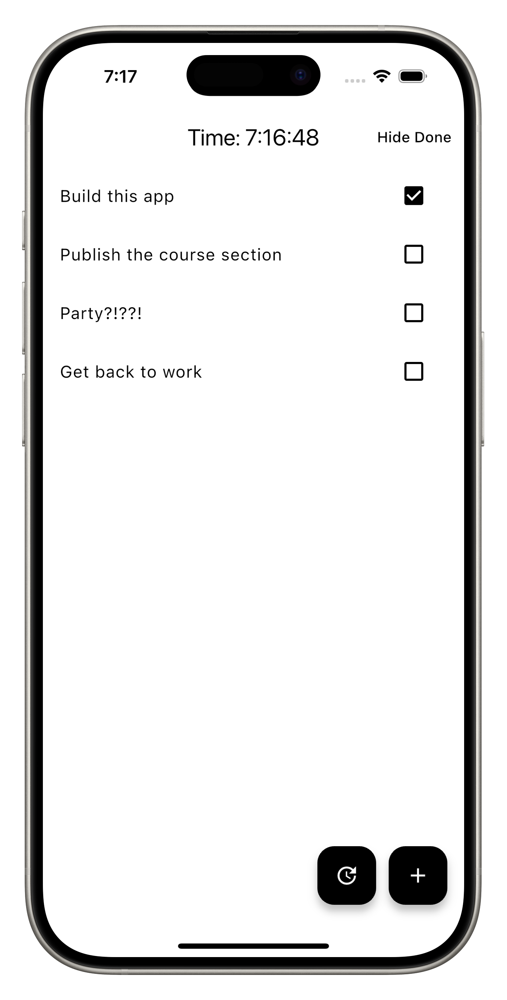
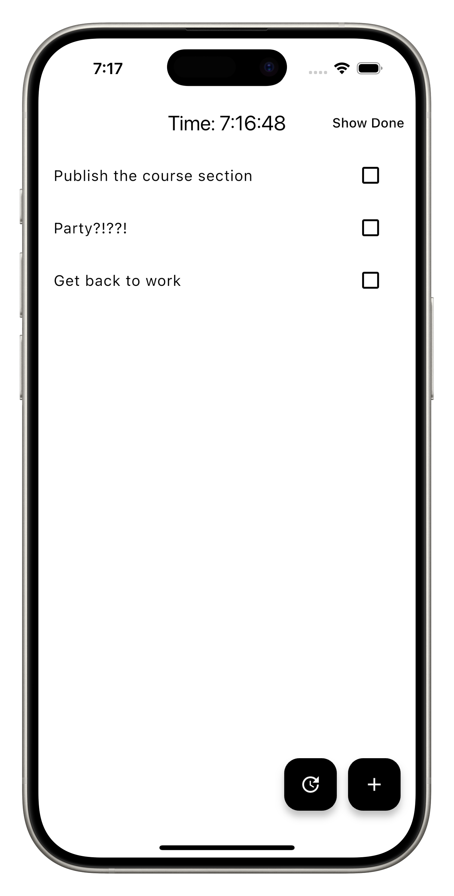
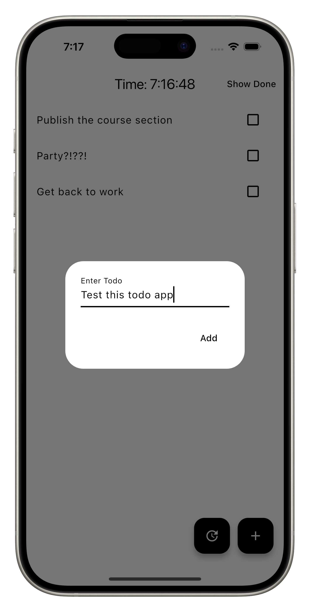

# Project Introduction

In this project, we will implement the MVVM structure to see how it works in a complete application.

The project we will build is a Todo App because Todo Apps are the best apps to build when learning architecture. Architecture is complex, and a Todo App allows you to walk through every step of the complexity while keeping it as minimal as possible.

  

### What we will cover

This project will cover Model-View-ViewModel (MVVM) architecture and layer on top of Services and Locators.

We will cover the repository layer in a later project so that we can focus on the fundamentals of MVVM architecture. It will also make more sense when we have covered local storage, networking, and backend services.

## Quiz

**1. Why is a Todo App a good choice for learning architecture?**

- A) Because todos are fun
- B) Because it's the fastest to build
- C) It allows you to learn complexity while keeping the app minimal
- D) Because everyone uses todo apps

Answer

- C) It allows you to learn complexity while keeping the app minimal

---

[← Course overview](../../../README.md)
