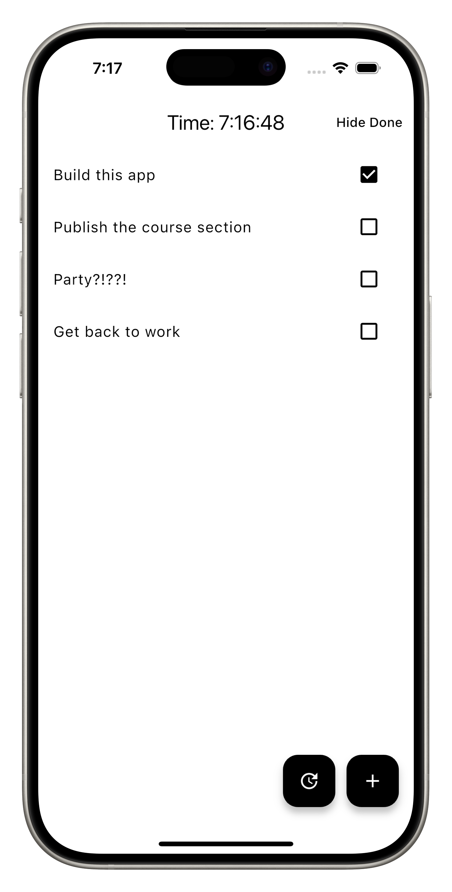
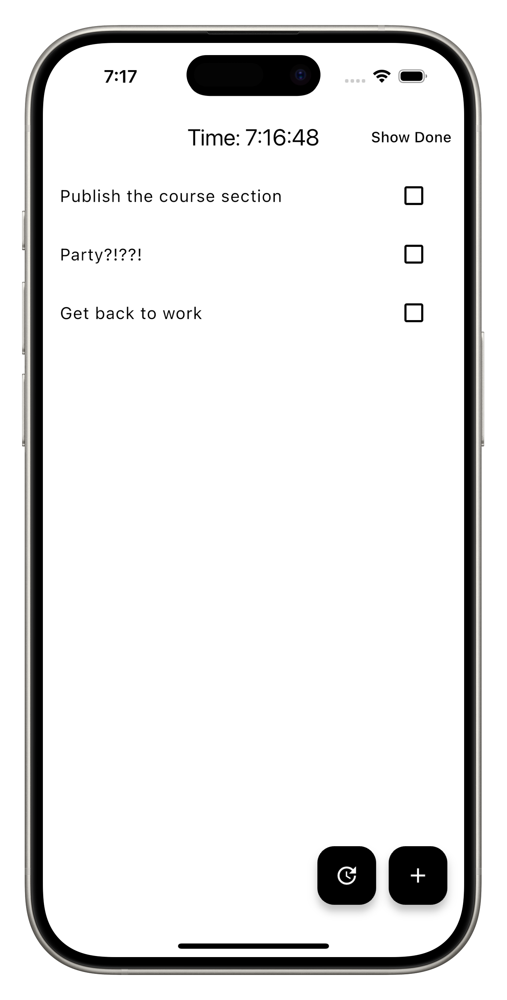
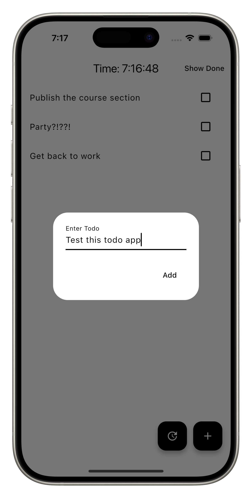

# Final Result

  

You have built a fully functional Todo App with MVVM architecture, Services, and Locators.

I hope you were able to accomplish some of the challenges yourself. You can continue challenging yourself by adding more features to this app.

You can [fork the repo here](https://github.com/hungrimind/flutter_todo) and continue building on top of it.

Some ideas for features:

- Add a `dueDate` to the todo item
- Add a `category` to the todo item
- Add a `note` to the todo item
- Add a `priority` to the todo item

When we first started building this project, we thought to include a repository layer, but we decided to save that for a later project because it made this initial project a lot more complex. If you are curious about what that would look like, you can check out the [pull request here](https://github.com/hungrimind/flutter_todo/pull/3).

We are adding a backend section to this course, where we cover how your Flutter app should interact with outside dependencies. This will be a better example of how to use a repository layer.

## Quiz

**1. How well did you do?**

- A) I did great!
- B) I did okay
- C) I did not do well

Answer

- A) I did great!
- B) I did okay
- C) I did not do well

---

[← Course overview](../../../README.md)
