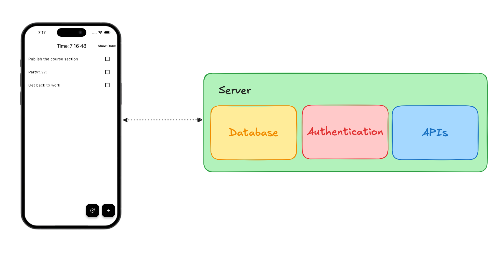

# What is a Backend?

The word "backend" is often thrown around casually, but it can be quite confusing since it can refer to many different things.

In web development the “Frontend”, is what the user interacts with and the “Backend” is the data manipulation happening on a different server.

When building mobile apps this distinction becomes a little fuzzy since there is App State and business logic that might not interact with the UI at the current moment.

What this section will cover is the “Backend” that is located outside our application. This can be on-device storage, cloud storage, and APIs.

What exactly is a backend, and why do our Flutter apps need one?

## Quiz

**1. What is not a backend in mobile development?**

- A) A database stored in the cloud.
- B) Data stored on the device.
- C) App wide state that is used in a service.
- D) An API used to retrieve the current weather.

Answer

- C) App wide state that is used in a service.

---

[← Course overview](../../../README.md)
