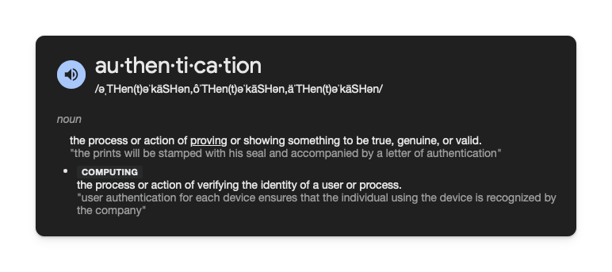
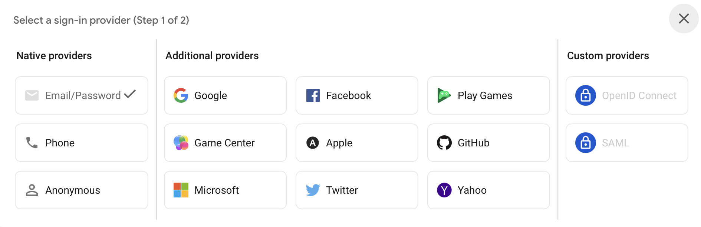

# What is Authentication?

Almost every app needs to know who its users are. Whether it's to save their preferences, protect their data, or provide personalized content - authentication is essential. Let's understand how it works in Flutter apps.

## What is Authentication?

Authentication is like having a security guard at a club:

- Checks if you're allowed in (login)
- Gives you a wristband (token)
- Checks your wristband when you move around (session)
- Takes your wristband when you leave (logout)

## How Authentication Works in Flutter

Flutter works the same way as any other front end application. The backend is a separate app, and Flutter needs to connect to it. Authentication is a part of a backend. Depending on what backend you are using, this can be done in a few different ways.

## Levels of Authentication

**Level 1: Knowledge Based Authentication** - This is something you know. It could be a username and password or a PIN code. In theory, anybody with this information can access your account.

**Level 2: Possession Based Authentication** - This is something you have. It could be a physical token like a key or a device like a phone. This is also called multi-factor authentication. This is more secure than knowledge based authentication.

**Level 3: Inherence Based Authentication** - This is something you are. It could be a biometric like a fingerprint or a face scan. This is the most secure form of authentication.

We are going to focus on the fundamentals of authentication, and how to use it with Flutter, but it is important to understand that there are different levels.

And for each level, there are different types of authentication. Here are a few examples from Firebase.

## Quiz

**1. What is the most secure form of authentication?**

- A) Knowledge Based Authentication
- B) Possession Based Authentication
- C) Inherence Based Authentication

Answer

- C) Inherence Based Authentication

**2. Which statement about authentication is correct?**

- A) Authentication is only needed for mobile apps
- B) Authentication is only about passwords
- C) Authentication verifies the identity of users

Answer

- C) Authentication verifies the identity of users

---

[← Course overview](../../../README.md)
