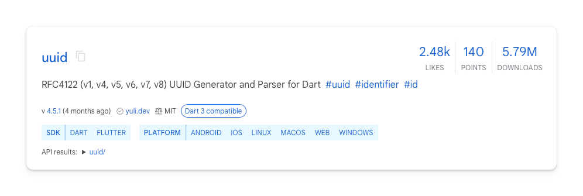

# Create User

A user's authentication journey always starts by creating a user. This has to be the first step, or there would be nothing to authenticate against.

## What is a user?

First and foremost, a user is a person. They are the ones that are using the app. They are the ones who interact with the app. They are the ones that are being authenticated.

Don't forget that.

But from the app's perspective, a user is a data object. They have some associated data like a name, email, and password, but most importantly, they have an ID. This ID is what is used to authenticate the user. It is often called a `uid` for user ID.

## UUIDs

Generating a unique ID for a user is more complex than it may seem.

You might think you can just increment a number in the database and be set. But what if this user is used across multiple databases? Or what if two users create an account at the same time? On top of that, using simple counters for IDs is not very secure.

There is a generally accepted algorithm called UUID that is used around the world. It was created by the Internet Engineering Task Force (IETF) and is a standard for generating unique identifiers. There are 8 different versions of these algorithms. You can read the [public documentation about UUIDs here](https://datatracker.ietf.org/doc/html/rfc9562). Some versions are no longer used, and v4 and v7 are the most popular.

- v4: Random
- v7: Time-based

You can use these algorithms in your app with the `uuid` package.

## Creating a user

The process of creating a user is relatively simple. You need to collect the appropriate data and then call the appropriate method to add it to your authentication service.

For example, if you are using Firebase Authentication with email and password authentication, you would use the `createUserWithEmailAndPassword` method.

## Assignment

We built a simplified authentication database into this app using SQLite (we will cover what this is in a later lesson). We also built a user service based on the MVVM architecture, which will be used to handle all the user data.

Your assignment is to create a `User` object in the database using the `createUser` method defined in the `UserService` class.

> Click "Show Database" in the top right corner of the app to see all the data stored in the database.

### Requirements

1. When you type a name in the field and click **Create Account**, a user entry will be created with a unique uid

> **Hint:** The function for creating a uuid is `Uuid().v4()`.

## Challenge

Code: [starter code](code/initial) · [solution](code/solution)

Start in `lib/auth/create_account_view_model.dart`. Tests: `test/create_account_test.dart`.

---

[← Course overview](../../../README.md)
