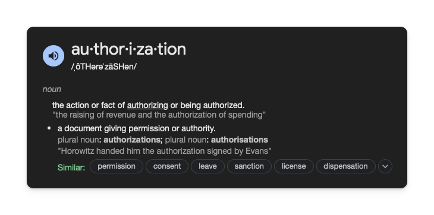

# Authorization

The last thing related to authentication is authorization. This is the process of checking if a user has permission to access a resource.

While not every app needs authorization, it is a common feature in many apps. Some users have different permissions or roles. For example, in a social media app, some users may have admin rights, which allow them to delete posts or ban other users.

## Assignment

Add an authorization check to check if the user's name is "admin". If it is, set them as an admin.

### Requirements

1. If the user's name is "admin", set the `isAdmin` property to `1` (we use `1` to represent true and `0` to represent false in SQLite).
2. In the app, when you log in as "admin", you should see the option to delete all the user data from the database.

## Challenge

Code: [starter code](code/initial) · [solution](code/solution)

Start in `lib/auth/create_account_view_model.dart`. Tests: `test/create_account_test.dart`, `test/login_test.dart`, `test/home_test.dart`.

---

[← Course overview](../../../README.md)
