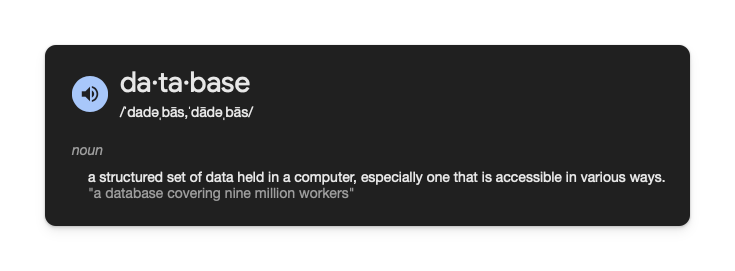

# What is a Database?

Most apps need somewhere to store data. Without data storage, your app can't do much.

Whether it's your user's profile information, their high scores in a game, or messages in a chat app - this data needs to live somewhere.

That somewhere is called a database.

A database is a structured collection of data. It is a system that stores, retrieves, and manages data efficiently.

A database is like a super-powered filing cabinet for your app's data. It helps you:

- Store data permanently
- Find data quickly
- Keep data organized
- Share data between users
- Keep data safe

## How Databases Work in Flutter

Again, Flutter is a frontend framework. The backend is a separate app that Flutter connects to. Authentication was one part of that backend, and a database is another commonly used part of the backend.

## Types of Databases

A database can be a relational or non-relational database and can be stored locally or in the cloud. We cover what this means in the next few lessons.

## Quiz

**1. Which of these is NOT a main benefit of using a database?**

- A) Storing data permanently
- B) Writing code faster
- C) Finding data quickly
- D) Keeping data organized

Answer

- B) Writing code faster

**2. In Flutter applications, where is the database typically located?**

- A) Only within the Flutter app
- B) Handwritten on a piece of paper
- C) In the backend, separate from the Flutter app
- D) In the user's web browser

Answer

- C) In the backend, separate from the Flutter app

---

[← Course overview](../../../README.md)
