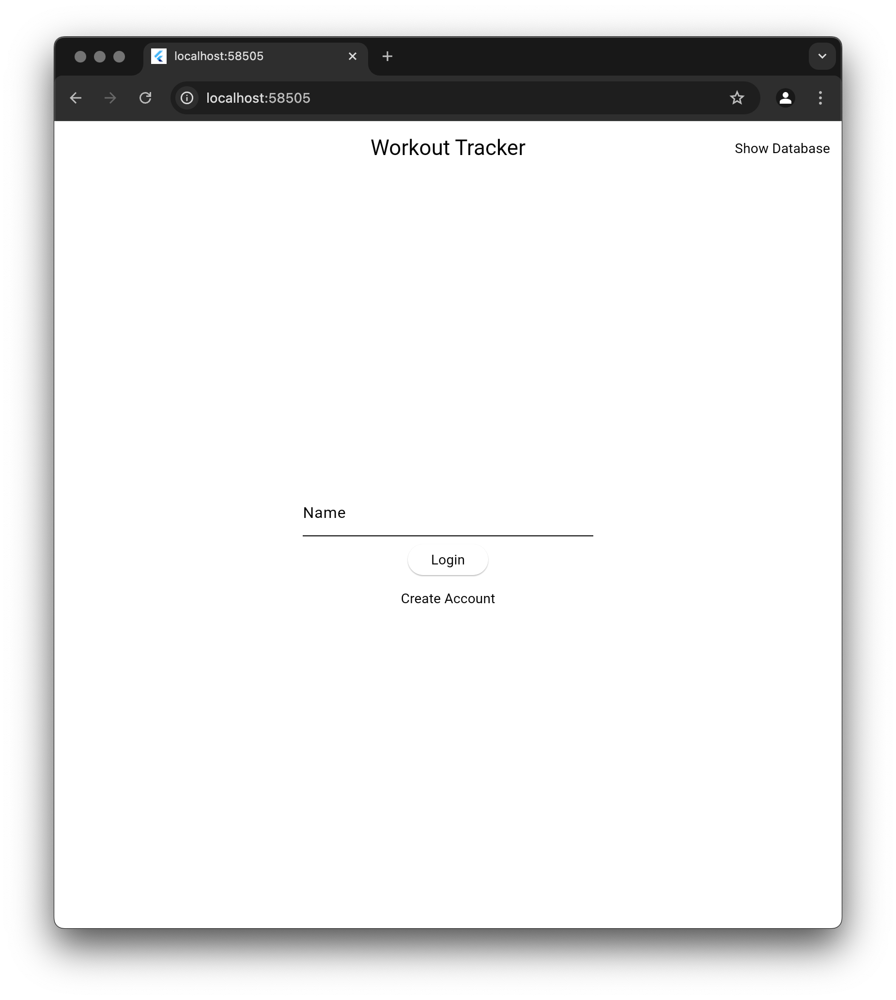
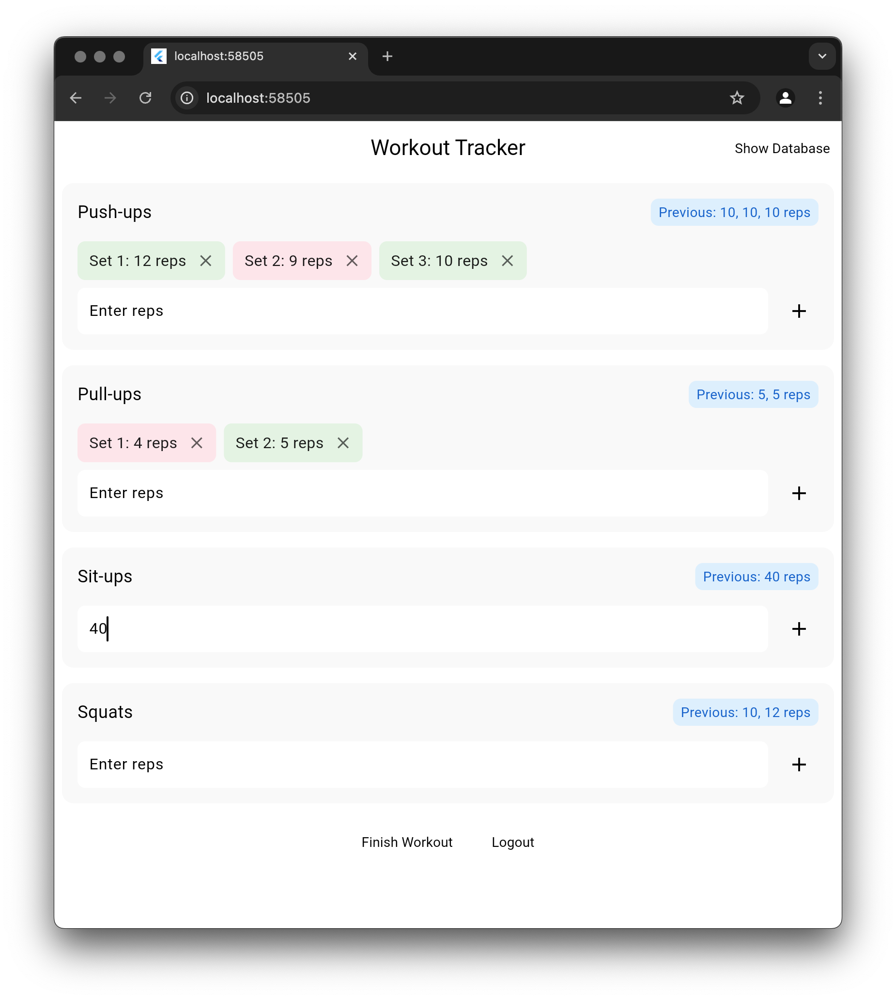

# Project Introduction

We have learned all the core concepts of building most Flutter apps.

Now it's time to build a complete app that includes a backend and repository layer and covers the complete MVVM architecture.

 

## Project Description

We will build a workout app. It will be a simple app that allows you to track your workouts.

You will be able to:

- Create an account
- Login to the app
- Logout from the app
- View previous rep count
- Add a new rep count

We will provide you with the UI from the beginning; your job will be to handle all the logic and do it using production ready MVVM architecture.

Although this app is simple, it covers all the core concepts of building a Flutter app.

If you can build this app, you can build any app you want.

## Quiz

**1. Are you ready?**

- A) Yes
- B) No

Answer

- A) Yes

---

[← Course overview](../../../README.md)
