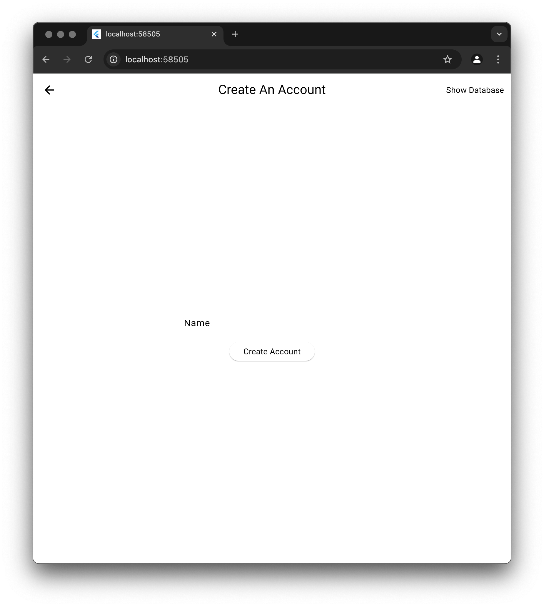

# Starting Point

Our starting point will be where we ended in the **Authentication** lesson.

> If you would like us to go through and rebuild this authentication section step by step, let us know in the Discord by clicking the `? Help` button in the top right.

As a refresher, let's review what we have in the code.

### Authentication

There are two screens:

1. `login_view.dart`
2. `create_account_view.dart`

 

Both use the `UserService` to handle user authentication and provide the user's state in our application.

This `UserService` is a singleton provided by our locator, which is initialized in the `main.dart` file.

### Database

We are using `sqlite` to store our data. A `DatabaseAbstraction` is used to interact with the database directly. This app will have four tables:

1. `users`
2. `sessions`
3. `workout_sessions,`
4. `exercise_sets`

We have already been using the `users` and `sessions` tables since we built those in the **authentication** lesson, and we will get into the rest later.

So that is what we have at this point. We can log in, create an account, and store and retrieve user sessions.

Now, let's make this a workout app.

## Assignment

Update this to be a workout app, and make it Hungrimind black and white style.

### Requirements

1. `AppBar` should say "Workout Tracker" on the login screen.
2. Update the ColorScheme to be `ColorScheme.light(primary: Colors.black)` so it matches the Hungrimind style.

## Challenge

Code: [starter code](code/initial) · [solution](code/solution)

Start in `lib/main.dart`. Tests: `test/create_account_test.dart`, `test/login_test.dart`, `test/workout_test.dart`.

---

[← Course overview](../../../README.md)
